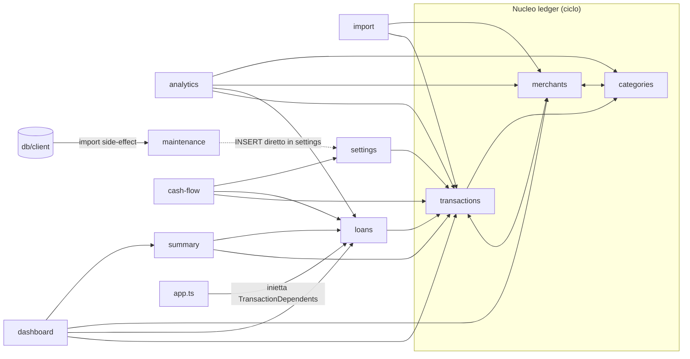

# Audit architetturale — Schedino (appConto / Personal Finance Tracker)

> Data: 2026-11-11 · Commit analizzato: `f072a59` (master, working tree pulito)
> Tipo: audit in sola lettura. Nessun file applicativo, test, configurazione o dato è stato modificato.
> Documenti collegati: [STATE_MACHINES.md](STATE_MACHINES.md) · [PLAN.md](PLAN.md)

Nel repository il progetto si chiama "Personal Finance Tracker" / `appconto`. La stringa "Schedino" non compare: in questo documento i due nomi indicano la stessa applicazione.

Legenda delle evidenze:

- **PROVEN**: dimostrato dal codice letto (o da un comando eseguito, quando indicato).
- **LIKELY**: rischio concreto che segue dal codice, ma non riprodotto.
- **POTENTIAL**: opportunità o rischio futuro.

I percorsi senza prefisso sono relativi a `apps/backend/src`. `frontend/…` indica `apps/frontend/src/app`.

---

## 1. Executive summary

**Risposta alla domanda fondamentale.** Sì, con riserve circoscritte. L'architettura di Schedino è proporzionata a un'applicazione locale a utente singolo e può crescere in funzionalità senza riscritture. Le sue scelte portanti sono solide:

- stato derivato invece che memorizzato;
- SQLite sincrono con un solo processo scrittore;
- importazione atomica e idempotente;
- pipeline di backup, migrazione e ripristino progettata per i guasti;
- test numerosi e isolati.

I punti che oggi rendono più costosa l'evoluzione non sono strutturali. Sono quattro:

1. **Un problema di igiene del repository, critico.** Un'istantanea del database personale reale (931 movimenti, dicembre 2019 – agosto 2026) è committata in un repository GitHub pubblico.
2. **Due difetti puntuali nei flussi più delicati.** Un ripristino può cancellare il proprio backup sorgente. Il lock d'istanza ha una finestra di race.
3. **Un cancello di verifica inaffidabile.** `npm run test:frontend` esce con codice 1 anche quando tutti gli 840 test passano. Non ci sono CI né istruzioni per agenti.
4. **Contratti e documentazione che divergono dal codice.** I DTO sono duplicati a mano nel frontend, le regole di dominio sono ricalcolate lato client e `architecture.md` e il README sono superati.

Nessuno di questi richiede nuovi framework o nuovi livelli. Il piano ([PLAN.md](PLAN.md)) è incrementale: la fase 0 (≈1–2 giorni) chiude i rischi P0/P1, le fasi successive consolidano confini, contratti e verificabilità.

| Dimensione | Punteggio | Sintesi |
|---|---|---|
| Architettura complessiva | 4/5 | Feature-oriented, confini chiari salvo il nucleo transazioni/merchant/categorie |
| UX | 3/5 | Buona prevenzione degli errori distruttivi. Lacune su coerenza post-reset, annunci accessibili e UI di backup |
| DX | 3/5 | Suite di test eccellente. Cancello di verifica rosso, nessuna CI/lint, README superato |
| AX | 3/5 | Convenzioni ripetibili e test leggibili. Nessun file d'istruzioni, docs architetturali superate, ~25 file per aggiungere un campo |
| Sicurezza applicativa | 4/5 | Bind su loopback, allowlist Host, controllo `Sec-Fetch-Site`, path traversal chiuso |
| Igiene dei dati nel repository | 1/5 | DB reale pubblicato (F01) |

---

## 2. Architettura attuale

### 2.1 Stack e modello di distribuzione

- **Frontend**: Angular 21 (componenti standalone, signals, `httpResource`), chart.js e lucide. Nessuna libreria UI. Ha il proprio `package.json`, `package-lock.json` e `node_modules` in `apps/frontend`.
- **Backend**: Node + Express 5, better-sqlite3 (sincrono), drizzle-orm 0.45, zod 4, papaparse. TypeScript `^7.0.2` alla radice, `~5.9` nel frontend.
- **Persistenza**: un file SQLite in `DATA_ROOT` (default `<APP_ROOT>/data/database.sqlite`, `paths.ts:199`), modalità WAL, `foreign_keys=ON` (`db/client.ts:33-34`). Ci sono 10 migrazioni drizzle in `apps/backend/drizzle/`.
- **Distribuzione**: applicazione locale a utente singolo. Il server ascolta solo su `127.0.0.1` (`config.ts:70`). Il pacchetto portabile per Windows comprende un launcher (`launcher/`) con lock d'istanza, canale di controllo TCP con token, IPC, readiness e apertura del browser.
- **Volumi**: circa 600 file tracciati, circa 34k righe nel backend (metà sono test) e circa 11,6k righe TypeScript nel frontend (spec escluse), oltre a 15k righe di spec.

### 2.2 Struttura del backend

```
apps/backend/src/
  main.ts, server.ts, bootstrap.ts, app.ts, shutdown.ts, listen.ts, config.ts, paths.ts, launcher-ipc.ts
  db/            client (apertura + restore pendente), safe-migrate, schema-version, sqlite
  shared/        errors (errori di dominio), http/ (error-handler, local-only, query-params, static), logger, sql, text
  launcher/      processo launcher Windows (lock, controllo, readiness, stop, browser)
  modules/
    transactions  merchants  categories      ← "nucleo ledger" (ciclo di dipendenze)
    import                                   ← pipeline CSV
    loans                                    ← prestiti e restituzioni
    analytics  dashboard  summary  cash-flow ← read model (solo lettura)
    settings                                 ← saldo iniziale
    maintenance                              ← backup, scheduler, restore differito, reset
```

Convenzione dei moduli (PROVEN): `<modulo>.{schema,repository,service,routes,dto|view-model,model}.ts` più `index.ts`, con test co-locati. I read model non hanno né schema né repository.

### 2.3 Struttura del frontend

```
frontend/
  core/            api base url, format, period, theme
  features/        analytics, categories, dashboard, import, loans, maintenance, merchants, settings, transactions
  shared/          layout/, transactions/ (tabella presentazionale), ui/ (chart, data, feedback, filters, forms)
```

Convenzione (PROVEN): `<nome>-page.ts`, `<nome>.api.ts`, `<nome>.model.ts`. `shared/` non importa mai da `features/`.

### 2.4 Flussi principali

1. **Importazione CSV.** Analisi del file (`POST /api/import/csv/analysis`), poi binding delle colonne (automatico o manuale), poi `POST /csv` o `/csv/mapped`. L'importazione esegue in un unico `atomically` la deduplicazione per fingerprint, la risoluzione o creazione dei merchant e l'inserimento (`import.service.ts:143-163`).
2. **Classificazione.** La categoria appartiene al merchant (`merchants.category_id`) e il movimento la eredita in lettura. Il valore NULL significa "da classificare".
3. **Lettura e analisi.** Dashboard, analytics, summary e cash-flow ricalcolano sempre gli aggregati dalle transazioni e dai prestiti. Nessuna statistica è memorizzata.
4. **Prestiti.** Un movimento `LOAN` origina uno o più prestiti. Le restituzioni (bancarie o in contanti) li riducono. Stato e residuo sono sempre derivati (`loan.model.ts:56-63`).
5. **Manutenzione.**
   - Backup verificati: `VACUUM INTO`, `integrity_check`, manifest con sha256.
   - Scheduler di backup automatici.
   - Ripristino in due tempi: preparato via HTTP, applicato al riavvio successivo prima di aprire il DB.
   - Reset con backup preventivo obbligatorio.
6. **Ciclo di vita del processo.** Prima si applica l'eventuale restore pendente e si apre il DB. Segue la migrazione sicura (backup obbligatorio). Poi l'app ascolta, lo scheduler parte e viene segnalato `ready` via IPC. In chiusura c'è uno shutdown ordinato con checkpoint del WAL.

---

## 3. Mappa dei moduli e delle dipendenze

### 3.1 Dipendenze tra moduli backend (PROVEN, import non di test)



Cicli e violazioni rilevati:

| ID | Descrizione | Evidenza | Tag |
|---|---|---|---|
| C1 | transactions ⇄ merchants | `transactions.service.ts:3,118` ↔ `merchants.service.ts:3,123`. Anche i DTO si importano a vicenda | PROVEN |
| C2 | categories ⇄ merchants | `categories.repository.ts:3` importa `merchants.schema`, che a sua volta importa `categories.schema` (`merchants.schema.ts:2`) | PROVEN |
| C3 | transactions → categories → merchants → transactions | composizione di C1 e C2 | PROVEN |
| V1 | Repository che scrivono tabelle di altri moduli | `categories.repository.ts:72-74` (UPDATE `merchants`), `reset.service.ts:149-151` (INSERT `settings`) | PROVEN |
| V2 | Import di file interni di altri moduli | `analytics.aggregation.ts:1` → `categories/category.model.js`, e gli import di `*.schema.js` da loans, merchants e transactions | PROVEN |
| V3 | Infrastruttura che dipende da una feature | `db/client.ts:4` importa `modules/maintenance/restore-pending.js` | PROVEN (scelta deliberata e documentata in `client.ts:24-31`) |

Il ciclo transactions → loans è stato evitato di proposito con l'interfaccia `TransactionDependents` (`transactions.routes.ts:32`, composta in `app.ts:56-61`). È l'esempio da seguire.

### 3.2 Dipendenze tra feature frontend (PROVEN)

- `transactions` ⇄ `loans`: `transactions-page.ts:17-18` e `transaction-loan-cell.ts:5` importano da loans, che importa da transactions in 8 punti.
- analytics, loans, merchants e dashboard importano `transaction-query`, `transaction-type`, `transaction.model` e `transactions.api`.
- `settings` incorpora `maintenance/reset-panel`.
- I file coinvolti sono modelli e API puri. Per un'app di questa dimensione il costo è tollerabile.

---

## 4. Modularità e scalabilità

| Criterio | Valutazione | Motivazione |
|---|---|---|
| Modularità | 3/5 | Undici moduli con convenzioni uniformi. Il nucleo ledger è però un cluster unico non separabile (C1–C3), e la documentazione non lo dichiara |
| Coesione | 4/5 | Ogni modulo contiene il suo schema, i servizi e le rotte. I read model sono foglie |
| Accoppiamento | 3/5 | Join cross-modulo nei repository (accettabili in un solo file SQLite) e scritture cross-tabella (V1). I commenti negli schema affermano il contrario |
| Evolvibilità | 4/5 | Aggiungere un read model o un endpoint è economico. Aggiungere un tipo di transazione richiede di toccare `transaction-type.ts` **e** la correzione del cash-flow (A4). Aggiungere un campo al movimento tocca circa 22–30 file (§10.3) |
| Scalabilità dei dati | 4/5 alla scala attuale | Da circa 1.000 a decine di migliaia di righe non ci sono problemi. Oltre circa 100k righe pesano gli indici mancanti e le aggregazioni in memoria (§8) |
| Scalabilità del team | 3/5 | Nessuna CI, nessun lint, contratto FE/BE non condiviso |

**Limiti strutturali alla crescita (POTENTIAL):**

- **Multi-conto** (citato nella visione). Nessuna entità `account`, e il saldo iniziale è un singleton. Richiederà una migrazione dello schema e una revisione del cash-flow. Il resto regge.
- **Regole di classificazione.** Oggi la classificazione è "categoria del merchant". Un motore di regole si inserirebbe naturalmente in `import.service` e `merchantResolver`. Nessun ostacolo architetturale.
- **Un secondo consumatore delle API**. Le forme di risposta sono eterogenee (§6.2) e gli errori non hanno codici macchina. Non è un problema finché il frontend resta l'unico client.

---

## 5. Audit della qualità del codice

### 5.1 Backend

Punti di forza (PROVEN):

- Il denaro è in centesimi interi end-to-end. `toAmountCents` arrotonda da stringa decimale, senza errori in virgola mobile.
- Assenza di `any` e `@ts-ignore`. C'è un solo `!` (`schema-version.ts:91`).
- Gli errori di dominio sono indipendenti dal protocollo (`shared/errors.ts`) e vengono mappati in un unico punto (`shared/http/error-handler.ts`).
- I commenti spiegano il "perché". I file lunghi (`loans.service.ts` 684 righe, `restore-pending.ts` 450) sono lineari e lunghi per buone ragioni: guardie esplicite e una matrice di recupero dai crash.

Debolezze:

| ID | Problema | Evidenza | Tag | Priorità |
|---|---|---|---|---|
| Q1 | Ramo morto nel gestore errori: ogni 4xx di Express riceve il messaggio "corpo non leggibile" | `shared/http/error-handler.ts:47-55`. Difetto già noto come "D1" | PROVEN | P3 |
| Q2 | La validazione degli enum nei query param è duplicata (13 occorrenze `includes(x as T)`), e `CLASSIFICATION_FILTERS` è dichiarato 3 volte | `transaction-query.ts:172-207`, `merchant-query.ts:72-100`, `loan-query.ts:58-80`, `analytics.query.ts:102-122` | PROVEN | P3 |
| Q3 | Helper per i parametri id copiato 4 volte | `requireId`, `categoryId`, `merchantId`, `required` nei rispettivi `*.routes.ts` | PROVEN | P3 |
| Q4 | Il confine di validazione è incoerente: alcune rotte usano zod nella route, loans/settings/import nel service. `parseOrThrow` restituisce solo il primo issue, e i messaggi zod predefiniti escono in inglese | `shared/validation.ts` | PROVEN / LIKELY (inglese) | P3 |
| Q5 | Codice morto | dipendenza `cors` (0 import), `shutdown.ts:196-240` (`installShutdownHandlers`, solo test), `transaction-type.ts:78` `affectsAccountBalance`, `transactionsService.listAll`, `merchantsService.listAll` | PROVEN | P3 |
| Q6 | Il seed "saldo iniziale sconosciuto" è definito in 3 punti | migrazione `0007`, `reset.service.ts:149-151`, `settings.repository.ts:8` | PROVEN | P3 |

### 5.2 Frontend

Punti di forza: tabella presentazionale con stato in factory (`createSelectionState`, `createTransactionEdits`), URL come fonte di verità sulle liste, validatori puri testabili, `parseAmount` che accetta entrambe le convenzioni decimali, e Select e ColorPicker accessibili da tastiera.

| ID | Problema | Evidenza | Tag | Priorità |
|---|---|---|---|---|
| Q7 | Tre stili di stato asincrono: `httpResource`, segnali manuali, async/await. Il "latch" che mantiene l'ultimo valore è riscritto 3 volte e il debounce di ricerca altre 3 | `analytics-page.ts:~127`, `dashboard-page.ts:64`, `merchants-page.ts:105` | PROVEN | P3 |
| Q8 | Le lookup di Analytics non hanno un gestore d'errore: se falliscono, i filtri sono vuoti senza messaggio | `analytics-page.ts:234-235` | PROVEN | P3 |
| Q9 | Formattazione duplicata e segno meno incoerente (trattino ASCII vs `typographicMinus`) | `loan-form.ts:57,121`, `core/format.ts`, `analytics-timeline.ts` | PROVEN | P3 |
| Q10 | `computed(() => x())` usato come wrapper di sola lettura dove basterebbe `.asReadonly()` | `transaction-delete.ts:24-27`, `transaction-edits.ts:52-53` | PROVEN | P3 |
| Q11 | Componenti grandi che mescolano viste e form | `loan-detail-page.ts` (347 righe, 3 form e 5 operazioni), `analytics-timeline.ts` (474) | PROVEN | P3 |

### 5.3 Lente Ponytail (sovra-ingegnerizzazione)

- **Giustificato, da congelare.** Il launcher (~1.100 righe non di test) e lo stack backup/restore rispondono ciascuno a un guasto reale: `process.kill` su Windows che salta i segnali, archivio corrotto, doppio avvio. Non vanno aggiunti ulteriori livelli.
- **Giustificato.** Le porte leggere (`SchedulerPort`, `MigrationPort`, `ServerDeps`, `TransactionDependents`) esistono dove i test o un ciclo le richiedono.
- **Da non estendere.** La DI dei router è applicata solo a 3 router su 12 (A5). Convertire gli altri non porta benefici.
- **Duplicazione da mantenere.** I quattro read model che valorizzano i movimenti tenendo conto dei prestiti condividono già le funzioni di semantica (`expenseCents`, `incomeCents`…). Resta solo l'idraulica del ciclo, che costa meno di un'astrazione.
- **Da eliminare.** Codice morto (Q5) e dipendenza `cors`.

---

## 6. Audit architetturale

### 6.1 Confronto fra regole dichiarate e realtà

Fonte delle regole: `docs/architecture/architecture.md:426-458`.

| Regola | Esito | Evidenza |
|---|---|---|
| Il frontend non accede mai al DB | VERIFIED | — |
| Il parser CSV non contiene logica di classificazione | VERIFIED | La risoluzione del tipo è un passo distinto (`resolveTransactionType`) |
| Le statistiche sono sempre calcolate | VERIFIED | Nessuna colonna aggregata. `loans.schema.ts` lo dichiara |
| Le transazioni importate sono immutabili | CONTRADICTED | `type` è modificabile (`transactions.service.ts:209-229`) e i movimenti sono cancellabili (`:252-288`). I campi bancari sono invece immutabili |
| Il dominio non dipende da Express | VERIFIED | I servizi non vedono `req`/`res` |
| Il dominio non dipende da SQLite | PARTIALLY | Le funzioni di dominio pure lo rispettano. I servizi importano `atomically` da `db/client` (accettabile) |
| Le feature comunicano attraverso servizi pubblici | CONTRADICTED | V1, V2 (7 punti) |

### 6.2 Contratti API

- Le convenzioni sono ragionevoli: `/api/<modulo>`, PATCH per le modifiche puntuali, 400/404/409 mappati centralmente, 404 JSON per `/api/*` sconosciute, prima del fallback SPA (PROVEN, `app.test.ts`).
- Le forme di risposta sono eterogenee: `{items, pagination}`, page DTO, `{query, totals, borrowers, items}`, array nudi; `DELETE` risponde 200 con corpo oppure 204 (PROVEN, P3). Va bene finché il client è uno solo.
- Gli errori hanno la forma `{error: string}` senza codice macchina (PROVEN, P3).
- **Nessun contratto condiviso FE/BE** (PROVEN, P2). Ogni `frontend/features/*/*.model.ts` ridichiara a mano i tipi del backend. `FALLBACK_CATEGORY_ID` è duplicato (`frontend/features/categories/categories-page.ts:19` e `categories.service.ts:13`). Un cambiamento nel backend si scopre solo a runtime.

### 6.3 Logica di dominio duplicata nel frontend (PROVEN che esiste, LIKELY che diverga)

- **Capacità del prestito.** `loan-create-page.ts:~87-120` somma i prestiti esistenti in euro (float JS) invece di usare `originSplit` del backend.
- **Periodi.** `core/period.ts` e `dashboard-month.ts` calcolano i limiti dei mesi con l'orologio del browser, mentre la dashboard usa il `today` del server.
- **Categoria protetta.** Duplicata come costante (vedi §6.2).

---

## 7. Sicurezza e affidabilità

### 7.1 Sicurezza (proporzionata a un'app locale)

| Aspetto | Esito | Evidenza |
|---|---|---|
| Esposizione di rete | Buono | Bind fisso su `127.0.0.1` (`config.ts:70`). Nessun override |
| DNS rebinding | Difeso | `hostAllowlist` accetta solo `localhost`, `127.0.0.1` e `[::1]` (`shared/http/local-only.ts`) |
| CSRF da una pagina web verso localhost | Difeso nei browser moderni | `sameOriginMutations` controlla `Origin` e `Sec-Fetch-Site`. CORS non è abilitato |
| Residuo CSRF | P3, LIKELY | `Origin: null` è esplicitamente accettato (`local-only.ts:96`). Le richieste prive di entrambi gli header passano (pensato per curl). Con un browser datato, il caso peggiore è un backup spurio o l'annullamento di un restore preparato. Il reset richiede JSON con `{"confirm":"AZZERA"}` |
| Path traversal | Chiuso | Regex stretta sui nomi di backup più contenimento del percorso risolto (`backup.naming.ts`) |
| Upload | Adeguato | Limite di 10 MB sul CSV. Parsing in memoria e sincrono |
| Canale di controllo del launcher | Adeguato | Loopback, porta casuale, token di 48 hex. Confronto non a tempo costante: irrilevante in locale |
| Esposizione d'errori | Adeguato | I 5xx restituiscono un messaggio generico. Lo stack finisce nel log. L'URL con query nei log dei 500 è un'eccezione dichiarata |
| **Dati reali nel repository** | **Critico (F01)** | Vedi §12 |
| Dipendenze | P2 | `npm audit --omit=dev` (eseguito dall'agente 2). Radice: 4 vulnerabilità (`proxy-addr` critica, `body-parser` alta, `zod` alta, `qs` moderata), tutte correggibili. Frontend: 6 (Angular `<21.2.20`: `@angular/router` alta, solo SSR, non usato; sanitization bypass in `@angular/core`/`compiler` moderata) |

### 7.2 Consistenza e concorrenza

- **Modello di concorrenza (PROVEN).** better-sqlite3 è sincrono, quindi esiste un solo processo con una sola connessione e due richieste HTTP non si interlacciano mai dentro un handler. Le sequenze check-then-write di loans e categories sono sicure **finché nessuno inserisce un `await`** fra controllo e scrittura. È un invariante implicito, non documentato (POTENTIAL).
- **Atomicità (PROVEN).** Import, cancellazione multipla, cancellazione di categoria e reset usano `atomically` (con SAVEPOINT annidati). La cancellazione multipla è tutto-o-niente.
- **Vincoli DB.** FK attive, UNIQUE su `fingerprint`, `normalized_name` e `categories.name`. **Nessun CHECK**: il segno degli importi, il tipo e la capienza dei prestiti sono garantiti solo dal servizio (PROVEN, P3).
- **Single-writer.** Garantito dal lock d'istanza, che però è acquisito solo dal launcher (`launcher/run.ts:138`). `main.ts` non lo acquisisce (A8).
- **Difetti di affidabilità nei flussi critici** (dettagli in [STATE_MACHINES.md](STATE_MACHINES.md)):
  - F02 (R1): il restore può cancellare il proprio backup sorgente.
  - F03 (L1): race nel furto del lock stantio.
  - F12 (R2): un re-stage fallito lascia un marker che punta a un candidato cancellato.
  - F13 (SM7): `VACUUM` dopo il commit del reset. Se fallisce, restituisce 500 anche se il reset è avvenuto.

---

## 8. Performance

Alla scala di un archivio personale (migliaia o decine di migliaia di righe) **non emergono problemi reali**. Rischi futuri (PROVEN nel codice, POTENTIAL nell'impatto):

| ID | Problema | Evidenza | Soglia di rilevanza |
|---|---|---|---|
| P-1 | Mancano indici su `transactions.booking_date`, `merchant_id` e `type`. Le query mensili usano `LIKE 'YYYY-MM-%'`, che non può usare un indice | `transactions.repository.ts:259,340`. Indici esistenti solo nelle migrazioni 0000/0004/0008 | ~100k righe |
| P-2 | `withMerchant` carica tutti i merchant e tutte le categorie a ogni chiamata | `transactions.service.ts:117-125` | Migliaia di merchant |
| P-3 | La ricerca merchant aggrega e ordina tutto a ogni pagina | `merchantsService.search` → `listSummaries()` | Migliaia di merchant |
| P-4 | Analytics carica in memoria l'intero intervallo | `analyticsService.getAnalytics` | Intervalli pluriennali con oltre 100k righe |
| P-5 | `VACUUM INTO`, `integrity_check` e sha256 sono sincroni sull'event loop. Il download di un backup lo verifica interamente | `backup.service.ts` | DB di centinaia di MB |

N+1: nessuno significativo. `loans.detailOf` esegue poche `findById` limitate.

---

## 9. Testing

### 9.1 Esecuzioni effettive (orchestratore, 2026-11-11)

| Comando | Esito |
|---|---|
| `npm run typecheck:backend` | Pulito |
| `npm run test:backend` | **1059/1059 pass**, 291 suite, ~24 s |
| `npm run test:frontend` | **840/840 pass** in 77 file, ma **2 errori non gestiti** ("Http failure response for /api/categories: 0 Unknown Error") originati da `src/app/app.spec.ts`. **Codice di uscita 1** |

Causa dell'uscita 1 (PROVEN): `app.spec.ts:11` registra `provideHttpClient()` reale senza `provideHttpClientTesting()`. Il test di navigazione fa partire richieste XHR vere. Compaiono anche avvisi `HTMLCanvasElement.getContext` (jsdom senza canvas), che non sono fatali.

### 9.2 Inventario

- **Backend**: 81 file `*.test.ts` (node:test via tsx), in prevalenza integrazione su SQLite reale in una cartella temporanea. Comprendono 3 test di processo (`*.runtime.test.ts`) e scenari completi del launcher con un server finto.
- **Frontend**: 77 spec con Vitest su jsdom. Componenti TestBed con `HttpTestingController` e logica pura. Circa 10% sono guardie su CSS e token.
- **Assenti**: e2e, CI (nessun `.github`), ESLint, soglie di coverage. Prettier è presente solo nel frontend e non è imposto.

### 9.3 Copertura degli invarianti

| Invariante | Copertura | Lacuna |
|---|---|---|
| Idempotenza dell'import e deduplica | Forte (`import.test.ts:33-101`, atomicità, fingerprint, vincolo UNIQUE) | Nessuna |
| Parsing CSV (date, importi, colonne) | Forte, con un round-trip di tipo property-based | CSV avversari o con codifiche esotiche non verificati |
| Ciclo di vita dei prestiti | Forte (7 file, incluse proiezioni cross-view) | — |
| Fallback categoria / migrazione 0009 | Coperto | — |
| Backup, restore, reset, migrazione | Molto forte | **Nessun test per R1** (restore dal pre-restore più vecchio con 3 già presenti) |
| Lock d'istanza | Scenari sequenziali | **Nessun test per L1** (due acquisizioni concorrenti su un lock stantio) |
| HTTP: validazione ed errori | Coperto | — |
| Pagina Import frontend | **Assente** (`import-page.ts` non ha spec) | Flusso utente principale scoperto (P2) |
| Pagina Settings frontend | Solo `settings-form.spec` | Il caso reset→form non è coperto (F04) |
| Bundle pacchettizzato | Solo manuale (`verify:package`) | Nessuno smoke automatico di `dist/server.js` |

### 9.4 Qualità dei test

- **Punti di forza.** Isolamento fail-closed (`test-support/isolate-database.ts` rifiuta qualsiasi DB fuori da tmp, e ha i suoi test). Nomi dei test in italiano che si leggono come specifiche. Orologio finto dove serve. Nessun `.only` o `.skip`.
- **Fragilità (P3).**
  - Polling con orologio reale nei test del launcher (`launcher/run.test.ts:152-168`, `readiness.test.ts:172-174`).
  - Test di runtime accoppiati al testo dei log (`runtime.test.ts:181`).
  - Contratto implicito sull'ordine degli import (`test-support/http-app.ts:46`).
  - Spec molto grandi (`analytics-page.spec` 1145 righe).

---

## 10. UX, DX e AX

### 10.1 UX: 3/5

**Punti di forza.**

- Conferma in loco delle cancellazioni, con la conseguenza esplicitata.
- Reset con parola digitata e backup preventivo.
- Azioni vietate nascoste o bloccate (categoria protetta, prestito con restituzioni).
- `httpResource` cancella le richieste superate, quindi nessuna risposta stantia sovrascrive quella nuova.
- Dati precedenti mantenuti attenuati durante il ricaricamento.
- Criteri nell'URL su Movimenti, Dashboard e Prestiti.

**Criticità.**

| ID | Problema | Evidenza | Tag | Priorità |
|---|---|---|---|---|
| F04 | Dopo un reset, la pagina Impostazioni mostra ancora saldo e data precedenti. Premendo Salva, si riscrivono valori che l'utente voleva azzerare | `reset.service.ts:150` riscrive `(0, null)`. `reset-panel.ts` non emette eventi. `settings-page.ts:52` carica una sola volta | PROVEN | P2 |
| F07 | Nessuna UI per backup e ripristino. Il messaggio del reset rimanda a "la sezione dei backup", che non esiste. Un reset bloccato da un restore pendente non si sblocca dalla UI. Le scritture fatte fra la preparazione e il riavvio vanno perse senza avviso (R3) | `maintenance.routes.ts:95,133`. Nessun uso di `/backups` o `/restore` in `frontend/` | PROVEN | P2 |
| F15 | La rimozione di una restituzione non chiede conferma | `loan-detail-page.html:307` | PROVEN | P2 |
| F16 | Accessibilità: esiti ed errori non annunciati (solo 2 `role="alert"`), nessun `aria-sort`, input file senza etichetta, `ErrorRetry` non annunciato | `import-page.html:11`, sortable-header | PROVEN | P2 |
| F17 | Import: la race fra due analisi consecutive può accoppiare il contenuto di B con la mappatura di A. Il pulsante resta attivo dopo l'importazione | `import-page.ts:97-100,165-173` | PROVEN (codice) / POTENTIAL (effetto) | P3 |
| F18 | I filtri di Analytics sono in uno store singleton e non nell'URL: si perdono al ricaricamento e restano ID stantii dopo cancellazioni o reset | `AnalyticsStore` `providedIn: 'root'` | PROVEN / LIKELY (ID stantii) | P3 |
| — | Tabella Movimenti: lo skeleton lampeggia al cambio filtro (incoerente con Analytics). `savingId` singolo nelle modifiche in linea. `prefill` doppio in loan-create | `transactions-page.ts`, `transaction-edits.ts:55-69`, `loan-create-page.ts:164-176` | PROVEN | P3 |

**Matrice degli stati per pagina** (dai template; "parziale" = presente ma incompleto)

| Pagina | Caricamento | Errore | Vuoto |
|---|---|---|---|
| Dashboard | sì (con dati precedenti attenuati) | sì (ErrorRetry) | per sezione |
| Analytics | sì | parziale: nessun retry, lookup silenziose | sì |
| Movimenti | sì (skeleton) | sì | sì (con "Reset filtri") |
| Prestiti / dettaglio | sì | sì | sì |
| Nuovo prestito | sì | solo testo | n/a |
| Merchant / Categorie | sì | sì | sì |
| Import | sì | solo testo | n/a |
| Impostazioni | sì | solo testo, il form resta visibile | n/a |

**Non verificato:** rendering reale, responsività, comportamento con screen reader. La UI non è stata eseguita.

### 10.2 DX: 3/5

**Punti di forza.** Un `npm install` alla radice per il backend e comandi chiari in `package.json`. `docs/rilascio.md` è pratico e attuale. Logger con un confine di privacy dichiarato e retention di 14 giorni. Messaggi d'errore di migrazione e restore molto chiari. Isolamento dei test che protegge l'archivio reale.

**Criticità.**

- F05: il cancello `npm test` è rosso.
- F06: nessuna CI e nessun comando unico di verifica.
- F08: README superato:
  - percorso del DB errato (`apps/backend/data/appconto.db` contro il reale `<APP_ROOT>/data/database.sqlite`);
  - non cita launcher, backup, variabili d'ambiente o `rilascio.md`;
  - non dice che il frontend ha una propria root d'installazione (LIKELY: su un clone pulito serve `npm install --prefix apps/frontend`).
- `apps/frontend/README.md` è il boilerplate di Angular CLI.
- Due versioni di TypeScript (7 nel backend, 5.9 nel frontend).
- Il frontend non ha uno script di typecheck separato.

### 10.3 AX: 3/5

**Punti di forza.** Convenzioni di file ripetibili in entrambe le app, test co-locati e descrittivi, `paths.ts` come unico punto di decisione per i percorsi, commenti orientati al "perché", errori tipizzati come unioni (`RestoreOutcome`, `MigrationOutcome`…).

**Criticità.**

- **Nessun `CLAUDE.md` o `AGENTS.md`** (PROVEN). Un agente deve ricostruire da solo:
  - i comandi di verifica e i loro tempi;
  - che i test sono node:test e Vitest, non Jest;
  - che il denaro è in centesimi;
  - che i nomi sono in italiano;
  - la precedenza di `DATA_ROOT` (`MYFINANCE_DATA` > `config/settings.json` > `DATABASE_FILE` > `<APP_ROOT>/data`);
  - il contratto sull'ordine degli import nei test;
  - l'invariante "handler sincroni".
- **Documentazione architetturale superata** (F09). `architecture.md` elenca 5 moduli con sottocartelle inesistenti. `project-context.md` non cita prestiti né manutenzione. In `docs/superpowers/` ci sono 22 piani e specifiche storiche senza indice: per un agente sono rumore, salvo quando tocca la feature corrispondente.
- **Costo di una modifica trasversale.** Aggiungere un campo al movimento tocca circa 11 file backend (schema, migrazione, model, repository, dto, service, routes, query, import, fingerprint se il campo entra nell'identità, view-model di analytics/dashboard/loans) e circa 8–10 file frontend. La forma del movimento è duplicata in 5 modelli di feature. Il compilatore intercetta gran parte degli errori backend. Quelli frontend emergono solo con `ng build` o `ng test`.
- **Verifica.** Un agente che esegue `npm test` vede un'uscita 1 senza test falliti. È un incentivo pericoloso a ignorare i codici di uscita.

---

## 11. Punti di forza da preservare

1. **Stato derivato, mai memorizzato.** Stato e residuo dei prestiti e tutte le statistiche sono calcolati, quindi non possono divergere dai dati.
2. **SQLite sincrono con un solo processo scrittore.** Elimina un'intera classe di race nel processo.
3. **Importazione atomica e idempotente**, con fingerprint UNIQUE nel DB.
4. **Pipeline di backup verificati**: file parziale, integrità, manifest sha256, rename atomico, retention come funzione pura testata.
5. **Migrazione sicura**: backup obbligatorio prima di migrare e rifiuto di un DB più recente dell'app.
6. **Restore differito** con punto di commit dichiarato, recupero della copia spostata e quarantena invece di retry in loop.
7. **Difese di rete proporzionate**: loopback, allowlist Host, `Sec-Fetch-Site`, nessun CORS.
8. **Errori di dominio indipendenti da HTTP**, mappati centralmente.
9. **`TransactionDependents`** per rompere il ciclo transactions → loans: è il modello da replicare.
10. **Suite di test** ampia, isolata e leggibile come specifica. Ci sono test di consistenza fra viste (rimborsi, prestiti).
11. **Frontend**: URL come stato, `shared/` indipendente dalle feature, prevenzione delle azioni distruttive.
12. **Logger** con confine di privacy.

---

## 12. Criticità classificate per priorità

Legenda impatto UX/DX/AX: effetto **dell'intervento proposto** su ciascuna dimensione.

| ID | P | Titolo | Area | Tag | Conf. | Impatto | Rischio di non intervento | UX | DX | AX |
|---|---|---|---|---|---|---|---|---|---|---|
| **F01** | **P0** | DB personale reale committato e pubblicato | Repository | PROVEN | HIGH | Esposizione di 931 movimenti, 452 merchant e 2 prestiti dell'autore (2019-12 → 2026-08) | Chiunque può clonare o fare un fork. Il dato resta nella cronologia | NEUTRAL | POSITIVE | POSITIVE |
| F02 | P1 | Il restore può cancellare il proprio backup sorgente (R1) | maintenance | PROVEN (lettura del codice, non riprodotto) | HIGH | Il ripristino fallisce con un 500 e il backup scelto è perso | Perdita di un punto di ripristino proprio quando serve | POSITIVE | NEUTRAL | NEUTRAL |
| F03 | P1 | Race nel furto del lock stantio: possibili due server sullo stesso archivio (L1) | launcher | LIKELY | MEDIUM | Due scrittori concorrenti, con restore, migrazione o checkpoint in conflitto | Corruzione o perdita di scritture dopo un crash seguito da un doppio clic | NEUTRAL | NEUTRAL | NEUTRAL |
| F05 | P1 | `npm run test:frontend` esce 1 con tutti i test verdi | Test FE | PROVEN (eseguito) | HIGH | Il cancello di verifica non è affidabile | Regressioni reali mascherate e agenti che imparano a ignorare i fallimenti | NEUTRAL | POSITIVE | POSITIVE |
| F06 | P1 | Nessuna CI e nessun comando unico di verifica | Tooling | PROVEN | HIGH | La verifica dipende dalla memoria di chi lavora | Regressioni scoperte tardi | NEUTRAL | POSITIVE | POSITIVE |
| F04 | P2 | Le Impostazioni mostrano dati stantii dopo il reset; Salva li riscrive | FE settings | PROVEN | HIGH | Incoerenza visibile, possibile riscrittura dei dati | Saldo iniziale errato dopo un reset | POSITIVE | NEUTRAL | NEUTRAL |
| F07 | P2 | Backup e restore senza UI; messaggi che rimandano a sezioni inesistenti; perdita silenziosa delle scritture dopo lo stage | FE + maintenance | PROVEN | HIGH | Funzione critica raggiungibile solo via API | L'utente non sa come recuperare | POSITIVE | NEUTRAL | NEUTRAL |
| F08 | P2 | README superato (percorso DB, installazione FE, variabili d'ambiente) | Docs | PROVEN / LIKELY | HIGH | Onboarding errato | Cancellazione della cartella sbagliata. Setup fallito su un clone pulito | NEUTRAL | POSITIVE | POSITIVE |
| F09 | P2 | Documentazione architetturale superata e nessun file d'istruzioni per agenti | Docs | PROVEN | HIGH | Costo di comprensione, regole false | Agenti e sviluppatori seguono regole che il codice non rispetta | NEUTRAL | POSITIVE | POSITIVE |
| F10 | P2 | Contratto FE/BE duplicato a mano, inclusi costanti e regole di dominio | FE/BE | PROVEN | HIGH | Le derive emergono solo a runtime | Bug silenziosi a ogni modifica di DTO | NEUTRAL | POSITIVE | POSITIVE |
| F11 | P2 | Un movimento d'origine può uscire dal tipo LOAN mentre il prestito resta aperto (LO1); l'asimmetria con le restituzioni non è documentata | loans/transactions | PROVEN | HIGH | Viste discordanti: spesa piena nel cash-flow, credito aperto nei prestiti | Numeri contraddittori fra le pagine | POSITIVE | NEUTRAL | POSITIVE |
| F14 | P2 | Vulnerabilità nelle dipendenze (`zod` alta, Angular `<21.2.20`, catena express) | Dipendenze | PROVEN (npm audit) | HIGH | Basso in locale | Accumulo di debito di aggiornamento | NEUTRAL | NEUTRAL | NEUTRAL |
| F15 | P2 | Rimozione di una restituzione senza conferma | FE loans | PROVEN | HIGH | Azione distruttiva con un solo clic | Errori dell'utente | POSITIVE | NEUTRAL | NEUTRAL |
| F16 | P2 | Annunci accessibili mancanti, `aria-sort`, etichetta dell'input file | FE | PROVEN | HIGH | Esiti non percepiti con tecnologie assistive | Esclusione | POSITIVE | NEUTRAL | NEUTRAL |
| F19 | P2 | La pagina Import (flusso principale) non ha spec | Test FE | PROVEN | HIGH | Regressioni non intercettate | — | NEUTRAL | POSITIVE | POSITIVE |
| F20 | P2 | Ciclo del nucleo ledger e scritture cross-tabella non dichiarate; i commenti negli schema sono falsi | BE | PROVEN | HIGH | Accoppiamento nascosto | Modifiche a uno schema che ne rompono altri | NEUTRAL | POSITIVE | POSITIVE |
| F21 | P2 | I movimenti cancellati ritornano reimportando lo stesso estratto (I1); la regola non è dichiarata | import | PROVEN | HIGH | Comportamento sorprendente | L'utente ricancella a ogni import | POSITIVE | NEUTRAL | POSITIVE |
| F12 | P3 | Un re-stage fallito lascia un marker verso un candidato cancellato (R2) | maintenance | PROVEN | HIGH | Stato pendente fuorviante, che fallisce in modo sicuro | Messaggio errato al riavvio | POSITIVE | NEUTRAL | NEUTRAL |
| F13 | P3 | `VACUUM` dopo il commit del reset: 500 anche se il reset è avvenuto | maintenance | LIKELY | MEDIUM | Esito riportato in modo errato | Confusione | POSITIVE | NEUTRAL | NEUTRAL |
| F22 | P3 | Il lock d'istanza è acquisito solo dal launcher (A8) | BE | PROVEN / POTENTIAL | MEDIUM | Dev e pacchetto sulla stessa `DATA_ROOT` diventano due scrittori | Solo se si condivide la `DATA_ROOT` | NEUTRAL | NEUTRAL | NEUTRAL |
| F23 | P3 | Launcher: nessun timeout prima di `ready` (L2); un figlio ucciso da segnale risulta uscito con codice 0 (L3) | launcher | POTENTIAL / LIKELY | MEDIUM | Attesa indefinita, diagnosi errata | Raro | POSITIVE | POSITIVE | NEUTRAL |
| F24 | P3 | Indici mancanti e aggregazioni in memoria (P-1…P-5) | BE perf | PROVEN / POTENTIAL | HIGH | Nessun impatto oggi | Lentezza oltre ~100k righe | POSITIVE | NEUTRAL | NEUTRAL |
| F25 | P3 | `Origin: null` accettato, richieste senza header accettate | BE security | PROVEN | MEDIUM | Solo browser datati | Backup spurio o annullamento di un restore | NEUTRAL | NEUTRAL | NEUTRAL |
| F26 | P3 | Pulizia del codice: Q1–Q6 (ramo morto, duplicazioni di validazione, codice morto, `cors`) | BE | PROVEN | HIGH | Rumore e messaggi fuorvianti | Costo di lettura | NEUTRAL | POSITIVE | POSITIVE |
| F27 | P3 | Pulizia del frontend: Q7–Q11, stato di Analytics fuori dall'URL (F18), race nell'import (F17) | FE | PROVEN | HIGH | Incoerenze minori | Costo di manutenzione | POSITIVE | POSITIVE | POSITIVE |
| F28 | P3 | Fragilità dei test (orologio reale, testo dei log) e nessuno smoke test del bundle | Test | PROVEN / LIKELY | MEDIUM | Flakiness futura | Falsi rossi su macchine lente | NEUTRAL | POSITIVE | POSITIVE |
| F29 | P3 | Invarianti dei prestiti solo applicativi; l'invariante "handler sincroni" non è documentato | BE | PROVEN / POTENTIAL | MEDIUM | Nessun impatto oggi | Race introdotte da un `await` futuro | NEUTRAL | POSITIVE | POSITIVE |

Gli ID non sono consecutivi per priorità perché seguono l'ordine di scoperta. [PLAN.md](PLAN.md) li riprende uno per uno.

### 12.1 Nota su F01 (P0)

`apps/backend/data-backup-p2-20260901/` (`appconto.db`, `-shm`, `-wal`) è tracciata da git ed è presente in `origin/master`. Il repository `StefanoMarano80017/appConto` risponde 200 all'API pubblica di GitHub senza autenticazione, quindi è **pubblico**. Il conteggio delle righe è stato fatto su una copia temporanea, senza leggere i contenuti: 931 transazioni, 452 merchant, 22 categorie, 2 prestiti, 1 restituzione, con date dal 2019-12-09 al 2026-08-22. `.gitignore` copre `apps/backend/data/` ma non questa cartella sorella.

Cancellare il file in un nuovo commit **non basta**. Bisogna riscrivere la cronologia e, prima ancora, valutare di rendere privato il repository. Va considerato che i dati possano essere già stati copiati (fork, cache, mirror). La riscrittura della cronologia è un'operazione irreversibile e va decisa dal proprietario: questo audit non l'ha eseguita.

---

## 13. Valutazione del documento di handoff

Non esiste un file `HANDOFF.md`, `ARCHITECTURE.md` alla radice o `CLAUDE.md`. Fanno le veci del documento di handoff:

- `docs/architecture/project-context.md` (visione e principi);
- `docs/architecture/architecture.md` (architettura);
- `README.md` (stato dei Work Package);
- `docs/rilascio.md` (guida operativa).

| Affermazione | Fonte | Esito | Evidenza |
|---|---|---|---|
| App web locale, DB embedded, nessun server da configurare | project-context | VERIFIED | `db/client.ts`, `config.ts:70` |
| Codice organizzato per funzionalità | project-context, architecture | VERIFIED | `modules/*`, `features/*` |
| Ogni modulo contiene `routes/ services/ repositories/ models/ dto/` | architecture:217-231 | CONTRADICTED | File piatti con suffissi puntati, nessuna sottocartella |
| Moduli: import, transactions, merchants, categories, analytics | architecture:199-215 | OUTDATED | 11 moduli, oltre a launcher e maintenance |
| Classificazione separata dall'importazione | project-context:145-151 | PARTIALLY VERIFIED | Il parser è puro. La risoluzione del merchant avviene nella stessa transazione d'import (scelta corretta per l'atomicità) |
| Statistiche sempre calcolate, mai memorizzate | entrambi | VERIFIED | Nessuna colonna aggregata |
| Le transazioni importate sono immutabili | architecture:444; anche `transaction.model.ts` | CONTRADICTED | `type` è modificabile, i movimenti sono cancellabili |
| Il dominio non dipende da Express | architecture:448 | VERIFIED | — |
| Il dominio non dipende da SQLite | architecture:452 | PARTIALLY VERIFIED | Le funzioni pure sì, i servizi usano `atomically` |
| Le feature comunicano via servizi pubblici | architecture:456 | CONTRADICTED | §3.1 V1/V2 |
| Errori gestiti centralmente; le feature non conoscono HTTP | architecture:384-392 | VERIFIED | `shared/http/error-handler.ts` |
| Le operazioni di dominio non conoscono il logging | architecture:406 | PARTIALLY VERIFIED | I servizi di maintenance e import loggano direttamente (scelta ragionevole) |
| Ogni modifica passa attraverso i repository | architecture:354 | PARTIALLY VERIFIED | `reset.service.ts:143-151` usa SQL diretto |
| Esempi di API (`POST /import/csv/analysis`, `PATCH /merchants/:id/category`…) | architecture:366-376 | VERIFIED | Montate sotto `/api` |
| Fuori scope: autenticazione, multi-conto, budget, forecasting | project-context:185-196 | VERIFIED | Assenti |
| Roadmap M1–M5 | project-context:249-269 | OUTDATED | Il README documenta WP1–WP9. Prestiti, manutenzione e launcher non sono citati in project-context |
| WP1–WP9 implementati | README | VERIFIED | Moduli e test corrispondenti |
| DB in `apps/backend/data/appconto.db`; per ripartire si cancella `apps/backend/data/` | README:53-57 | CONTRADICTED | `paths.ts:199`: `<APP_ROOT>/data/database.sqlite`. `.gitignore` definisce `apps/backend/data/` "posizione storica" |
| `npm install`, poi `npm run dev:frontend` | README:46 | PARTIALLY VERIFIED | I comandi esistono. Il frontend però ha una propria root d'installazione e non ci sono workspaces: LIKELY incompleto su un clone pulito |
| `paths.ts` è l'unico punto che decide i percorsi | rilascio.md | VERIFIED | — |
| `data-model.md`, `offline-first-portable.md`, `report_wp_p*.md` | docs/architecture | NOT VERIFIABLE (non confrontati riga per riga) | `data-model.md` cita i prestiti. I report WP sono storici |
| `frontend-shared-components-proposal.md` | docs/architecture | OUTDATED | Cita una feature `cash-flow` e un `SegmentedControl` che non esistono. La regola di dipendenza `shared` → `features` è invece rispettata |

**Architettura desiderata e architettura reale.** La visione dei documenti (Domain First, livelli separati, moduli autosufficienti) è più rigida della realtà. La realtà è una **architettura modulare pragmatica**:

- moduli feature-oriented a file piatti;
- un nucleo ledger accoppiato;
- read model trasversali;
- un'infrastruttura di manutenzione molto curata.

È una buona architettura. Il problema è che i documenti descrivono un'altra architettura. Conviene allineare i documenti al codice, non il codice ai documenti.

---

## Appendice A: metodo e limiti

**Agenti.** Quattro subagent indipendenti con brief separati. Nessuno ha ricevuto le conclusioni degli altri.

| Agente | Area | Modello |
|---|---|---|
| 1 | Architettura, dominio, state machine | Opus |
| 2 | Backend, API, dati, sicurezza, performance (incluso `npm audit`) | Sonnet |
| 3 | Frontend, UX, interazione | Sonnet |
| 4 | Testing, affidabilità, DX, AX | Sonnet |

Orchestrazione, verifica delle evidenze e sintesi: Opus. La lente Ponytail (`ponytail-audit`) è stata applicata trasversalmente in sintesi.

**Verifiche dell'orchestratore sul codice.** Tutte le criticità P0–P2 sono state ricontrollate sul codice:

- F01: `git ls-tree origin/master`, API GitHub, conteggio righe su una copia temporanea poi eliminata.
- F02: ordine `create` → `prune` → `copyFileSync` in `restore.service.ts:90-105` e `backup.service.ts:218`.
- F03: `instance-lock.ts:236-244`.
- F04: `reset.service.ts:150`, `settings-page.ts:52`, `reset-panel.ts`.
- F05: esecuzione con codice d'uscita e `app.spec.ts:11`.
- F08: `paths.ts:199`.
- F10: `FALLBACK_CATEGORY_ID` doppio.
- F11: `transactions.service.ts:215-224`.
- F15: `loan-detail-page.html:307`.
- Q1, `cors`, indici, `Origin: null`, codice morto.

**Non eseguito o non verificabile.**

- Nessuna riproduzione a runtime di F02 e F03: le prove vengono dalla lettura del codice.
- UI non renderizzata: responsività e screen reader non sono stati verificati.
- Nessun CSV avversario provato contro il rilevatore di colonne.
- Comportamento del filesystem Windows (rename su file bloccati, antivirus) non testato.
- Bundle pacchettizzato non costruito né avviato (`npm run package` modifica `dist-package/`).
- Percentuale di coverage non misurata (nessuno strumento configurato).
- Cronologia git non esaminata alla ricerca di segreti, oltre al DB.
- `data-model.md` non confrontato riga per riga con lo schema.
- Se il repository abbia fork o copie esterne.
