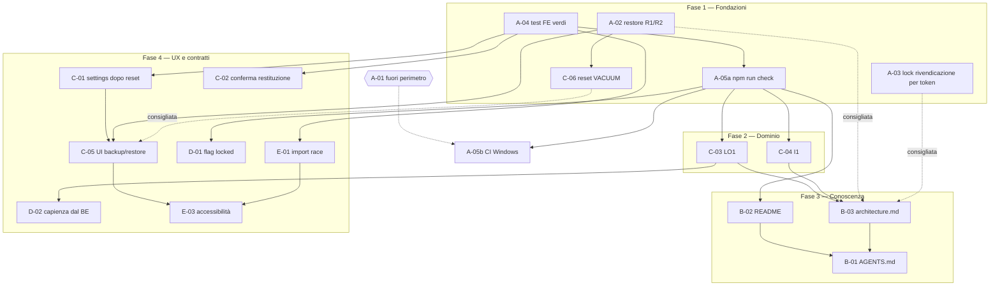

# Piano di consolidamento architetturale — Schedino

> Revisione 2 · 2026-11-11 · Baseline dell'audit: commit `f072a59`
> Documenti collegati: [AUDIT.md](AUDIT.md) (risultanze F01–F29) e [STATE_MACHINES.md](STATE_MACHINES.md) (macchine SM1–SM9, F1–F7).
> Questo documento è un **piano**. Nessuna attività è stata implementata. Sostituisce la revisione 1 dello stesso file.

---

## 1. Contesto e obiettivi

### 1.1 Baseline

- L'audit fotografa il commit `f072a59`.
- Alla data di questa revisione `HEAD` coincide ancora con `f072a59`. Il working tree contiene solo la cartella non tracciata `docs/architecture-audit/`. Nessun file applicativo è cambiato dopo l'audit.
- Le risultanze dell'audit sono state ricontrollate sul codice per le aree critiche (`maintenance/`, `launcher/`, `transactions/`, `loans/`, `import/`, frontend di settings, maintenance, loans, import e transactions). I riferimenti `file:riga` di questo piano sono aggiornati a questa verifica.
- La verifica ha prodotto **correzioni rispetto all'audit**:
  - **L1 è più grave di quanto descritto.** Al furto del lock non c'è alcuna rilettura del token: `rmSync` è incondizionato (`instance-lock.ts:238-243`). La rilettura esiste solo in `release()` (`:196-199`).
  - **Il guard D9/LO1 dipende dal chiamante.** Il parametro `dependents` di `updateType` è facoltativo (`transactions.service.ts:209,215`). Un chiamante che lo omette salta ogni vincolo. Oggi l'unico chiamante di produzione, la rotta, lo passa sempre (`transactions.routes.ts:108`).
  - **La cancellazione dei movimenti ha un solo punto d'ingresso:** l'eliminazione multipla della selezione (`DELETE /api/transactions` con `ids[]`, `transactions.routes.ts:81-90`). Non esiste una cancellazione singola.
  - **La capienza del prestito non è esposta dal backend.** `GET /api/loans/links` restituisce, per legame, solo `transactionId, loanId, role, borrowerName, amount, remainingAmount, status`. In caso d'errore il frontend ricade su `prefill(0)` e mostra l'intera capienza (`loan-create-page.ts:166-173`).
  - **Il riordino proposto per A-02 nella revisione 1 non bastava.** Copiare il candidato prima del backup di sicurezza evita l'`ENOENT`, ma `prune()` elimina comunque il backup scelto.
  - **Un restore pendente blocca il reset con 409** (`reset.service.ts:101`), e l'interfaccia non offre alcun modo per annullarlo.

### 1.2 Domanda guida

> Qual è il percorso più semplice, sicuro ed efficace per eliminare le criticità individuate nell'audit e preparare Schedino a crescere senza aumentare inutilmente la complessità?

### 1.3 Obiettivi del consolidamento

1. **Affidabilità dei workflow critici.**
   - Il restore non può perdere il backup scelto né lasciare marker incoerenti.
   - Un solo processo alla volta può possedere un archivio.
   - L'esito del reset è riportato correttamente.
2. **Controlli automatici affidabili.**
   - Un comando locale unico con esito inequivocabile.
   - Una CI su Windows, quando il prerequisito esterno sarà risolto.
3. **Regole di dominio esplicite e garantite nel livello corretto:** LO1 nel backend, I1 dichiarata all'utente.
4. **Conoscenza allineata al codice:** README, architettura, `AGENTS.md`.
5. **Interfaccia coerente dopo operazioni distruttive e asincrone:**
   - stato dopo il reset;
   - conferme;
   - backup e restore visibili;
   - race dell'import;
   - annunci accessibili.
6. **Meno regole duplicate fra frontend e backend,** con soluzioni proporzionate.

### 1.4 Perimetro incluso

- Affidabilità di backup, restore, reset e launcher.
- Regole di dominio e state machine.
- Test e comando di verifica.
- CI, con il vincolo descritto in A-05b.
- Documentazione tecnica, DX e AX.
- Contratti frontend/backend.
- UX e accessibilità.
- Manutenibilità.
- Performance, solo quando misurata.

### 1.5 Elementi esclusi

Gli interventi di **sicurezza del repository e dei dati personali** sono rinviati a un intervento separato e sono elencati nella §10:

- A-01/F01, il database personale nel repository pubblico;
- E-02/F14, le dipendenze vulnerabili;
- F-05/F25, l'hardening di `local-only`.

L'esclusione **non** significa che siano risolti.

Restano invece **pienamente inclusi** gli interventi di integrità dei dati: backup, restore, atomicità, consistenza, lock d'istanza e prevenzione delle perdite.

---

## 2. Decisioni di dominio definitive

Le due decisioni sono definitive. Questo piano non presenta alternative. Per ciascuna si distingue il **comportamento deciso** (target) dal **comportamento attuale** del codice.

### 2.1 LO1 — Il tipo di un movimento d'origine di prestiti è bloccato

**Regola funzionale (invariante).** Un movimento che è l'origine di almeno un prestito (`loans.transaction_id = movimento.id`) non può cambiare tipo, finché esiste almeno uno di quei prestiti.

**Semantica di "prestito collegato".**
- Il collegamento è la riga in `loans`: colonna `transaction_id`, `NOT NULL`, con FK verso `transactions.id` (`loans.schema.ts:26-28`).
- Il collegamento **non cessa** quando il prestito è restituito: lo stato è derivato e il legame resta (`loans.service.ts:440-442`). Il blocco vale quindi per prestiti aperti, parzialmente restituiti e restituiti.
- Il collegamento cessa **solo** quando il prestito viene eliminato. Oggi l'eliminazione è possibile solo se il prestito non ha restituzioni (`loans.service.ts:562-571`).
- Un movimento può originare più prestiti (spesa parziale, capienza `|amount|`). Basta un prestito per bloccare il tipo.
- Conseguenza dichiarata: per correggere il tipo di un'origine bisogna:
  1. rimuovere le restituzioni;
  2. eliminare il prestito;
  3. correggere il tipo.

  La risposta 409 deve dirlo.

**Comportamento attuale.**
- Il cambio di tipo di un'origine è **consentito**. `updateType` blocca solo gli utilizzi con `requiresIncome` (`transactions.service.ts:215-224`), che vale `true` solo per `REPAYMENT` (`loans.service.ts:478`).
- Il risultato è uno stato incoerente: il prestito resta, ma cash-flow e dashboard trattano il movimento come non-LOAN (`cash-flow.service.ts:39`, `dashboard.service.ts:182-187`). La pagina Prestiti segnala `transactionTypeMismatch` (`loans.service.ts:311`).

**Dove è garantita.** Nel servizio applicativo `transactionsService.updateType`, con il meccanismo `dependents.usagesOf` già esistente, che la rotta passa sempre. Un test di rotta lo verifica. Il contratto "ogni chiamante di produzione passa `dependents`" è dichiarato nel commento del metodo e in `AGENTS.md`.

**Operazioni coinvolte.**
- `PATCH /api/transactions/:id/type` (l'unico punto di cambio tipo; l'import assegna il tipo solo all'inserimento).
- La creazione di un prestito, che richiede già un'origine di tipo `LOAN` (`loans.service.ts:120`).

**Effetti sulle altre feature.**
- Cash-flow, analytics e dashboard restano coerenti per costruzione.
- `transactionTypeMismatch` resta, per gli archivi con incoerenze già presenti. Diventa irraggiungibile per i dati nuovi.
- Il ripristino di un'origine legacy al tipo `LOAN` resta consentito.

**Test.** Vedi C-03.

**Documentazione da aggiornare dopo l'implementazione:** `architecture.md` (B-03), `AGENTS.md` (B-01).

### 2.2 I1 — Movimenti cancellati e reimportazione: comportamento invariato, reso esplicito

**Regola funzionale.** La cancellazione rimuove il movimento. L'import resta idempotente sul fingerprint dei soli movimenti **presenti**. Un movimento cancellato può quindi ricomparire se si reimporta un estratto che lo contiene. È un comportamento voluto.

**Comportamento attuale.** Coincide con la decisione.
- Il fingerprint è calcolato in `transaction-fingerprint.ts`.
- Il rilevamento dei duplicati è in `import/duplicate-detector.ts:17-30`, tramite `findExistingFingerprints` (`transactions.repository.ts:378`).
- Il commento in `transactions.service.ts:244-250` lo dichiara già.

Mancano due cose:
- la dichiarazione all'utente;
- un test che fissi il comportamento. Nessun test cancella e poi reimporta: `import.test.ts:33,53,66,85` non cancellano nulla.

**Dove è garantita.** Nessun cambiamento di codice di dominio. La garanzia è un test backend di caratterizzazione più il testo di conferma.

**Operazioni coinvolte.** L'unico punto d'ingresso: la cancellazione della selezione (`transactions-table-panel.html:51-60`, host `transactions-page.ts:259-262, 293-323`).

**Vietato in questo perimetro:**
- `ignored_fingerprints`;
- tombstone;
- nuove tabelle, migrazioni o stato persistito;
- modifiche alla deduplicazione.

**Documentazione:** `architecture.md` (B-03), `AGENTS.md` (B-01).

### 2.3 Conseguenze sul piano

| Decisione | Attività | Ordine |
|---|---|---|
| LO1 | C-03 (BE + FE) | Prima di B-03, B-01 e D-02 (D-02 per file condivisi) |
| I1 | C-04 (UX + test) | Prima di B-03 e B-01 |

La documentazione (B-03, B-01) descrive LO1 e I1 **solo dopo** C-03 e C-04.

---

## 3. Stato attuale delle attività (verificato su `f072a59`, aggiornato il 2026-11-11)

Legenda: NOT STARTED · IN PROGRESS · COMPLETED · PARTIALLY COMPLETED · BLOCKED · DEFERRED.

| ID orig. | Stato | Evidenza | Lavoro residuo / nuova collocazione |
|---|---|---|---|
| A-01 | DEFERRED (fuori perimetro) | Cartella `apps/backend/data-backup-p2-20260901/` ancora tracciata | §10 |
| A-02 | COMPLETED (2026-11-11) | `prune(protect)` e `create(..., protect)` in `backup.service.ts`; `clearPendingRestore()` prima della sostituzione del candidato in `restore.service.ts`; test T1–T4 | — |
| A-03 | NOT STARTED | `instance-lock.ts:238-243`: `rmSync` senza alcuna verifica del token | Intera attività, ridisegnata (rivendicazione del furto per token) |
| A-04 | COMPLETED (2026-11-11) | `npm run test:frontend` esce con 0; 840/840; nessun "Unhandled Errors". Rotte reali con pagine vuote in `app.spec.ts` (vedi scheda) | — |
| A-05 | Divisa | — | **A-05a** COMPLETED (2026-11-11): script `check` nel `package.json` radice, esito 0 a progetto sano e ≠ 0 per ciascun passo rotto. **A-05b** BLOCKED da A-01 |
| B-01 | NOT STARTED | Nessun `AGENTS.md`/`CLAUDE.md` nel repository | Intera attività |
| B-02 | NOT STARTED | `README.md:53` cita `apps/backend/data/appconto.db`; il file reale è `database.sqlite` (`paths.ts:127`) | Intera attività |
| B-03 | NOT STARTED | `architecture.md:197-217` elenca 5 moduli su 11; regole false a `:444` e `:456` | Intera attività, dopo C-03 e C-04 |
| C-01 | NOT STARTED | `settings-page.ts:52-68` carica una sola volta; `reset-panel.ts:63-69` non emette nulla | Intera attività; manca `settings-page.spec.ts` |
| C-02 | NOT STARTED | `loan-detail-page.html:300-311`: clic diretto su `removeRepayment` | Intera attività |
| C-03 | NOT STARTED | `transactions.service.ts:215-224` blocca solo `requiresIncome` | Riformulata: decisione LO1 definitiva |
| C-04 | PARTIALLY COMPLETED | Il comportamento è già quello deciso e il commento BE lo dichiara (`transactions.service.ts:244-250`). Mancano il testo UI e il test | Testo di conferma + test di caratterizzazione |
| C-05 | NOT STARTED | Il frontend ha solo `maintenance.api.ts` con `reset()`. Il backend ha tutte le API | Intera attività; include l'annullamento del restore pendente |
| C-06 | NOT STARTED | `reset.service.ts:161`: `vacuum()` senza try/catch dopo il commit | Intera attività |
| D-01 | NOT STARTED | `categories-page.ts:19` duplica `FALLBACK_CATEGORY_ID` | Intera attività |
| D-02 | NOT STARTED | `loan-create-page.ts:87-93,112,159` calcola in euro float; il backend non espone la capienza | Riformulata: il backend espone la capienza residua |
| D-03 | NOT STARTED | — | Opzionale |
| E-01 | NOT STARTED | `import-page.ts:84-108` senza token; input file mai disabilitato (`import-page.html:12`); nessuna spec | Intera attività |
| E-02 | DEFERRED (fuori perimetro) | — | §10 |
| E-03 | NOT STARTED | `error-retry`, `sortable-header` senza ruoli/`aria-sort` | Intera attività, lista dei punti estesa |
| E-04 | NOT STARTED | — | Rinviabile |
| E-05 | NOT STARTED | — | Condizionale a A-05b |
| E-06 | NOT STARTED | — | Opzionale |
| E-07 | NOT STARTED | `main.ts` non acquisisce il lock (A8 confermato) | Opzionale, dopo A-03 |
| F-01…F-04, F-06…F-12 | NOT STARTED | — | Opzionali (§9) |
| F-05 | DEFERRED (fuori perimetro) | — | §10 |
| G-01, G-02 | NOT STARTED | — | Rinviabili (§9) |

Al 2026-11-11 sono COMPLETED A-04, A-05a e A-02 (evidenze nelle schede e in `PROGRESS.md`). Nessuna attività è IN PROGRESS. Le modifiche non sono ancora committate: HEAD resta `f072a59`.

---

## 4. Principi di intervento

- **Incrementale.**
  - Ogni attività è un incremento autonomo che lascia l'applicazione funzionante e `npm run check` verde, una volta che A-05a esiste.
  - Nessuna riscrittura.
- **Test prima della correzione.**
  - Ogni difetto concreto (R1, R2, L1, F04/C-01, race dell'import, LO1) si riproduce con un test che **fallisce** prima della correzione.
  - Le decisioni che confermano un comportamento esistente (I1) si fissano con un test di caratterizzazione.
- **Nessun overengineering.**
  - Prima di ogni attività: "esiste una soluzione più semplice che risolve completamente il problema?".
  - Niente nuove librerie, livelli architetturali, workspace, pacchetti condivisi, store globali o librerie di state machine.
- **Preservare ciò che funziona** (AUDIT §11):
  - stato derivato;
  - SQLite sincrono a scrittore unico;
  - import atomico e idempotente;
  - pipeline di backup verificata;
  - difese di rete locali;
  - suite di test isolata dall'archivio reale.
- **Comportamenti non coinvolti invariati.** Un'attività non cambia comportamenti fuori dal proprio ambito. Se un test esistente cambia, la scheda lo elenca.
- **Equilibrio UX/DX/AX.** Ogni attività deve migliorare almeno una dimensione senza peggiorare le altre.
- **Mai l'archivio reale.** Ogni verifica usa `DATA_ROOT` temporanee: `MYFINANCE_DATA` puntata a una cartella di scratch, oppure il preload `isolate-database` dei test.

---

## 5. Roadmap

| Fase | Obiettivo | Attività | Prerequisiti | Risultato verificabile | Condizione per proseguire |
|---|---|---|---|---|---|
| **1 — Fondazioni e affidabilità** | Controlli affidabili; nessuna perdita di backup; scrittore unico garantito | A-04 → A-05a; A-02 → C-06; A-03 | Nessuno | `npm run check` esce con 0; test R1/R2/L1 verdi | `npm run check` verde e test R1, R2, L1 presenti e verdi |
| **2 — Regole di dominio** | LO1 garantita dal backend; I1 dichiarata | C-03; C-04 | A-05a | 409 su retype di un'origine; testo di conferma aggiornato; test I1 | Regole implementate e coperte da test |
| **3 — Conoscenza architetturale** | Documenti che descrivono il codice e le regole implementate | B-02; B-03 → B-01 | A-05a, C-03, C-04 | README eseguibile su clone pulito; `AGENTS.md` < 120 righe | Ogni comando e percorso citato esiste |
| **4 — UX dei workflow e contratti** | Interfaccia coerente su reset, backup/restore, conferme, import, accessibilità; meno regole duplicate | C-01 → C-05; C-02; D-01; D-02; E-01; E-03 | A-04; A-02 (e C-06) per C-05; C-03 per D-02 | Spec dei nuovi stati; nessuna costante o calcolo duplicato | Spec verdi; prova manuale di restore completata su archivio temporaneo |
| **Binario CI** | Controllo remoto su Windows | A-05b | A-05a **e** risoluzione di A-01 (fuori perimetro) | Workflow verde su master; PR con test rotto rossa | — |
| **Opzionali** | Pulizia e performance solo quando giustificate | D-03, E-04…E-07, F-*, G-* | Vedi §9 | — | — |

Le fasi 2 e 4 possono iniziare in parallelo con la fase 3 sulle aree che non condividono file (vedi §7). La sequenza rigida vale solo dentro le aree a rischio:
- `maintenance/`: A-02 → C-06 → C-05;
- `launcher/`: A-03 → E-07;
- `transactions.service.ts`: C-03 da solo;
- `loans/` backend: C-03 → D-02;
- `loan-detail-page`: C-02, poi F-10;
- frontend settings/maintenance: C-01 → C-05.

---

## 6. Schede delle attività

Scala di effort: **XS** ≤ mezza giornata · **S** ½–1 giorno · **M** 2–3 giorni · **L** 1 settimana · **XL** oltre.

### Fase 1 — Fondazioni e affidabilità

#### A-04 · Rendere verde `npm run test:frontend`

- **Stato iniziale:** NOT STARTED.
  - 840/840 test passano, ma il comando esce con 1.
  - `app.spec.ts:11` fornisce `provideHttpClient()` senza `provideHttpClientTesting()`. La navigazione verso le rotte reali emette XHR verso `/api/categories`, che jsdom non può soddisfare ("Unhandled Errors").
- **Problema:** F05. Un cancello rosso con test verdi insegna a ignorare i codici d'uscita.
- **Obiettivo:** il comando esce con 0 se e solo se tutti i test passano.
- **Regola:** nessuna spec emette richieste HTTP reali.
- **Intervento proposto:**
  - Aggiungere `provideHttpClientTesting()` dopo `provideHttpClient()` in `app.spec.ts`.
  - Se la spec naviga su rotte che fanno richieste, svuotarle o ignorarle con `HttpTestingController` nella stessa spec.
  - Non toccare il setup globale di Vitest, salvo che restino altri errori non gestiti.
- **Ambito:** `apps/frontend/src/app/app.spec.ts`.
- **Dipendenze:** nessuna.
- **Priorità:** P1 · **Classificazione:** Necessaria.
- **Effort:** XS: una riga, più eventuali attese HTTP nella stessa spec.
- **Rischio:** minimo. Possibile che emergano altri errori non gestiti oggi mascherati; vanno corretti nella stessa attività.
- **Strategia di testing:** eseguire `npm run test:frontend` e controllare il codice d'uscita.
- **Criteri di accettazione:**
  - `npm run test:frontend` esce con 0.
  - L'output non contiene "Unhandled Errors".
  - Il numero di test eseguiti non diminuisce (≥ 840).
- **Impatto UX/DX/AX:**
  - UX neutro.
  - DX positivo: esito affidabile.
  - AX fortemente positivo: un agente può fidarsi del codice d'uscita.
- **Risultato atteso:** cancello frontend affidabile.
- **Stato: COMPLETED (2026-11-11).**
  - **Deviazione dall'intervento proposto:** `provideHttpClientTesting()` da solo non basta. Con il backend finto le richieste restano pendenti e `fixture.whenStable()` le attende: i due test di navigazione andavano in timeout (5 s). Rispondere alle richieste avrebbe richiesto payload finti per ogni pagina.
  - **Intervento realizzato:** in `app.spec.ts` le rotte sono `routes.map(...)` con le pagine sostituite da un componente vuoto. Percorsi, titoli e redirect restano quelli reali di `app.routes.ts`. Nessuna pagina viene montata, quindi nessuna richiesta HTTP; i provider HTTP sono stati rimossi dalla spec perché la shell non li usa.
  - **Criteri verificati:** `npm run test:frontend` esce con 0; 77 file e 840 test passati (prima: 840 passati, 2 errori non gestiti da `app.spec.ts`, uscita 1); nessun "Unhandled Errors" nell'output.
  - **Limite noto:** `app.spec.ts` non verifica più che ogni rotta monti la propria pagina reale; nessun test lo faceva in modo esplicito prima. Le righe "Not implemented: HTMLCanvasElement's getContext()" sono avvisi di jsdom, non errori, e non influiscono sull'esito.

#### A-05a · Comando locale unico `npm run check`

- **Stato iniziale:** NOT STARTED.
  - Gli script radice esistenti sono: `dev`, `dev:backend`, `dev:frontend`, `start:backend`, `build`, `build:backend`, `build:frontend`, `start`, `package`, `verify:package`, `typecheck:backend`, `test`, `test:backend`, `test:frontend`, `db:generate`.
  - Non c'è `check`. Non esiste un typecheck frontend separato: lo fa `ng build`.
- **Problema:** F06. La verifica dipende dalla memoria di chi lavora.
- **Obiettivo:** un solo comando, eseguibile su Windows, che dice se il progetto è sano.
- **Intervento proposto:**
  - Aggiungere al `package.json` radice `"check": "npm run typecheck:backend && npm run test:backend && npm run test:frontend && npm run build"`.
  - `&&` funziona sia in `cmd` sia in PowerShell 7 (npm usa `cmd` su Windows).
  - Niente lint, coverage o matrici.
- **Ambito:** `package.json` radice.
- **Dipendenze:** A-04.
- **Priorità:** P1 · **Classificazione:** Necessaria.
- **Effort:** XS.
- **Rischio:** basso. Il comando è lento (test backend più build Angular); va dichiarata la durata indicativa in B-01.
- **Strategia di testing:** esecuzione del comando, più una prova con un test volutamente rotto, da non committare.
- **Criteri di accettazione:**
  - `npm run check` esce con 0 su Windows a progetto sano.
  - Esce con un valore diverso da 0 se un test backend o frontend fallisce, se il typecheck fallisce o se la build fallisce (provato una volta per ciascun caso in locale).
  - Dopo l'esecuzione `git status --porcelain` non mostra nuovi file né modifiche, a parte gli output ignorati da `.gitignore`.
- **Impatto UX/DX/AX:**
  - UX neutro.
  - DX positivo.
  - AX fortemente positivo: è la definizione operativa di "fatto".
- **Risultato atteso:** una riga per sapere se il progetto è sano.
- **Stato: COMPLETED (2026-11-11).**
  - **Intervento realizzato:** script `check` nel `package.json` radice, identico alla proposta.
  - **Criteri verificati:**
    - progetto sano: uscita 0 in circa 2 minuti (backend 1059/1059, frontend 840/840, build frontend e backend riuscite);
    - quattro prove negative con file sonda temporanei non tracciati, poi cancellati: errore di tipo nel backend, test backend fallito, spec frontend fallita, errore di tipo in un file frontend non importato dai test. In ogni caso uscita 1 e arresto al passo atteso (`typecheck:backend`, `test:backend`, `test:frontend`, `build:frontend`);
    - dopo le esecuzioni `git status --porcelain` mostra solo le modifiche intenzionali.
  - **Nota:** il typecheck del frontend avviene solo in `build:frontend` (`ng build`), alla fine del comando.

#### A-05b · Workflow CI su Windows

- **Stato iniziale:** **BLOCKED** dal prerequisito esterno A-01 (fuori perimetro). Il repository è pubblico e contiene ancora il database personale nella cronologia. L'attivazione di workflow remoti va rinviata alla bonifica.
- **Problema:** F06. Nessun controllo indipendente dalla macchina di chi sviluppa.
- **Obiettivo:** ogni push e ogni PR producono un esito verde o rosso inequivocabile, sul sistema operativo di destinazione.
- **Intervento proposto:** `.github/workflows/check.yml` con:
  - `runs-on: windows-latest`;
  - `actions/setup-node` con la versione di Node usata in locale (oggi non dichiarata: nessun `.nvmrc` né `engines`), da fissare **nel workflow**;
  - `npm ci`, `npm ci --prefix apps/frontend`, `npm run check`.

  Un solo job, nessuna matrice, nessuna cache obbligatoria.
- **Ambito:** `.github/workflows/check.yml`.
- **Dipendenze:** A-05a; risoluzione di A-01 (§10).
- **Priorità:** P1 · **Classificazione:** Necessaria, quando sbloccata.
- **Effort:** S: primo giro di aggiustamenti dell'ambiente Windows in CI.
- **Rischio:** medio-basso.
  - I test del launcher e di runtime potrebbero essere lenti o instabili su runner condivisi (vedi E-05).
  - Non verificato: durata reale su `windows-latest`.
- **Strategia di testing:** una PR di prova verde e una PR con un test rotto.
- **Criteri di accettazione:**
  - Il workflow è verde su master.
  - Una PR con un test rotto è rossa.
  - Il workflow non usa segreti.
- **Impatto UX/DX/AX:**
  - UX neutro.
  - DX positivo.
  - AX positivo: un agente legge l'esito della PR.
- **Risultato atteso:** regressioni intercettate prima del merge.

#### A-02 · Restore che non cancella la propria sorgente e non lascia marker orfani (R1, R2)

- **Stato iniziale:** NOT STARTED. Ordine attuale di `restoreService.stage()` (`restore.service.ts:62-135`):
  1. Controllo del marker `applying`.
  2. Verifica del backup (`:73`).
  3. Controllo della versione di schema.
  4. `backupService.create('pre-restore')` (intorno a `:88-90`, `catch` a `:91-100`), che termina con `prune()` (`backup.service.ts:218`, definizione `:377`). `prune()` conserva i 3 `pre-restore` più recenti (`backup.retention.ts:20`).
  5. `rmSync(candidate)` e `copyFileSync(check.file, candidate)` (`:104-105`), senza try/catch.
  6. Ispezione e sha256 del candidato (`:109`).
  7. `writePendingRestore` (`:131`).
- **Problema:**
  - **R1 (F02).** Se il backup scelto è il più vecchio dei 3 `pre-restore`, il passo 4 lo elimina con `prune()`. Il passo 5 fallisce con `ENOENT` e la risposta è un 500 non mappato. Il backup scelto è perso. È l'unico flusso che distrugge un punto di ripristino, e lo fa proprio quando l'utente ne ha bisogno. Le altre tipologie non sono toccate dalla retention dei `pre-restore`.
  - **R2.** Un marker `staged` precedente non viene azzerato prima di sostituire il candidato. Se il nuovo stage fallisce, o il processo cade fra i passi 5 e 7, il vecchio marker punta a un candidato assente o diverso. Al boot finisce in quarantena (`restore-pending.ts:327-360`): situazione sicura, ma confusa.
- **Obiettivo:**
  - Lo stage non elimina mai il backup scelto.
  - Lo stage riesce del tutto; oppure lascia invariato il restore preparato in precedenza, se fallisce prima di toccare il candidato; oppure lascia "nessun restore pendente", se fallisce dopo.
- **Regola o invariante:**
  - (I-R1) Il backup selezionato esiste ancora al termine dello stage, riuscito o fallito. La sua eventuale rimozione successiva può avvenire solo per la normale retention di una **successiva** creazione di backup, non per lo stage stesso.
  - (I-R2) Un marker presente punta sempre a un candidato presente con lo sha256 registrato.
- **Intervento proposto (nessuna nuova astrazione):**
  1. **R1:** `create` accetta un'opzione facoltativa `protect?: string[]`, inoltrata a `prune()`, che non elimina i nomi protetti. `stage()` chiama `create('pre-restore', moment, { protect: [name] })`. Gli altri chiamanti restano invariati. La causa è la retention, quindi la correzione sta nella retention, nel punto in cui viene invocata.
  2. **R2:** chiamare `clearPendingRestore()` dopo verifica, controllo dello schema e creazione del backup di sicurezza, cioè subito prima di `rmSync(candidate)` (`:104`). Un errore di validazione (400) o un fallimento del backup di sicurezza lasciano quindi intatto un restore già preparato. Da quel punto in poi, un fallimento lascia "nessun restore pendente", coerente con l'assenza del candidato.
  3. Nessun cambiamento alla scrittura del marker. Il marker resta scritto con `writeFileSync`: un marker troncato è già messo in quarantena al boot. Un `rename` con sostituzione su Windows aggiungerebbe un nuovo modo di fallire (`EPERM` sotto antivirus) anche nel percorso di boot (`restore-pending.ts:265`).

  Scartato il riordino "copia del candidato prima del backup di sicurezza": evita l'`ENOENT`, ma `prune()` eliminerebbe comunque il backup scelto.
- **Ambito:**
  - `modules/maintenance/backup.service.ts` (`create`, `prune`);
  - `modules/maintenance/restore.service.ts`;
  - test `restore.service.test.ts`, `backup.service.test.ts`.
- **Dipendenze:** nessuna. Area `maintenance/` in esclusiva: niente C-06 o C-05 in parallelo.
- **Priorità:** P1 · **Classificazione:** Necessaria.
- **Effort:** S: circa 10 righe più 3 test.
- **Rischio:** basso.
  - Lo stage non tocca l'archivio vivo.
  - Dopo uno stage di un `pre-restore` vecchio, i `pre-restore` sono temporaneamente 4. È voluto, e la creazione successiva riporta la retention a 3.
- **Strategia di testing (prima della correzione):**
  - T1: creare 3 backup `pre-restore` con retention reale e fare lo stage del più vecchio.
    - Oggi: il test fallisce con `ENOENT` e il backup scelto sparisce.
    - Dopo la correzione: lo stage riesce, lo sha del candidato coincide con quello del backup scelto e `GET /api/backups` elenca ancora il backup scelto.
  - T2: fare uno stage riuscito, poi uno stage di un nome inesistente o di un backup corrotto (errore 400). Il restore preparato in precedenza è ancora pendente e il suo candidato è intatto.
  - T3: fare uno stage riuscito, poi uno stage che fallisce dopo la sostituzione del candidato (per esempio con un'ispezione finta che fallisce). `GET /api/restore` restituisce `null` e non esiste un marker che punta a un candidato.
  - T4: `prune({ protect })` non elimina i nomi protetti e applica la retention agli altri.
  - Regressione: tutta la suite `modules/maintenance/` più `restore.runtime.test.ts`.
- **Criteri di accettazione:**
  - T1 e T3 falliscono prima della correzione e passano dopo.
  - T2 e T4 sono verdi.
  - La suite `maintenance/` è verde.
  - `npm run check` è verde.
- **Impatto UX/DX/AX:**
  - UX positivo: nessun 500 inspiegabile, nessun backup perso.
  - DX neutro.
  - AX positivo: invarianti espliciti nei test.
- **Risultato atteso:** il restore è sicuro da esporre in interfaccia (C-05).
- **Stato: COMPLETED (2026-11-11).**
  - **Intervento realizzato:** come proposto, con una semplificazione: `protect` è un terzo parametro posizionale (`create(kind, moment, protect = [])`, `prune(protect = [])`) invece di un oggetto di opzioni. Unico chiamante che lo passa: `restore.service.ts`. Gli altri chiamanti di `create` (`bootstrap.ts`, `auto-backup.ts`, `maintenance.routes.ts`, `reset.service.ts`) restano invariati.
  - **Test:** T1 e T4 nei nuovi describe di `restore.service.test.ts` e `backup.service.test.ts`; T2 e T3 in `restore.service.test.ts`. T3 provoca il fallimento mettendo una cartella al posto del candidato: `rmSync` fallisce subito dopo `clearPendingRestore()`.
  - **Criteri verificati:**
    - prima della correzione: T1 fallisce con `ENOENT` su `copyfile` del backup scelto; T3 e T4 falliscono; T2 è verde;
    - dopo la correzione: T1–T4 verdi; suite `maintenance/` più `restore.runtime.test.ts` 168/168;
    - `npm run check` esce con 0 (backend 1063/1063, frontend 840/840, build).
  - **Limite accettato:** la protezione vale per la sola creazione del pre-restore. La creazione successiva di un backup di qualsiasi tipo (anche automatico) esegue `prune()` senza protezione e può eliminare il backup scelto mentre il ripristino è ancora in attesa. L'apply non ne risente: usa il candidato in `tmp/`. Da tenere presente in C-05, se l'interfaccia mostra il nome del backup in attesa.

#### A-03 · Lock d'istanza: un solo processo può acquisire l'archivio (L1)

- **Stato iniziale:** NOT STARTED. Algoritmo attuale (`launcher/instance-lock.ts:134-243`, unico chiamante `launcher/run.ts:138`):
  1. Creazione `wx` del file di lock con un token.
  2. Su `EEXIST`, lettura del file. Se è illeggibile, attesa di 600 ms e nuova lettura.
  3. Ping di liveness sulla porta di controllo TCP del proprietario, che è effimera (`control.ts:186,279`).
  4. Se il proprietario non risponde, `rmSync(lockFile)` **incondizionato** (`:238-243`) e nuovo tentativo, fino a 4.
- **Problema:** F03. Due launcher A e B leggono lo stesso lock stantio L0 e lo giudicano entrambi morto. A rimuove L0 e crea L_A. B esegue `rmSync` e rimuove **L_A**, poi crea L_B. Entrambi ritengono di possedere l'archivio. In più, il `release()` di A trova un token estraneo e non rimuove nulla, e A continua senza lock.
  - **Perché la sola rilettura del token non basta.** Rileggere il token prima di `rmSync` restringe la finestra ma non la chiude. Fra la lettura di B e il suo `rmSync`, A può rimuovere L0 e creare L_A, e B cancellerebbe comunque L_A. Su un percorso, "controlla e poi agisci" non è atomico.
  - **Perché la rinomina atomica da sola non basta.** `renameSync(lock, lock.<uuid>)` è atomica e assegna la sorgente a un solo vincitore. Ma se il vincitore scopre di aver preso un lock *fresco* (token ≠ L0), deve rimetterlo a posto:
    - su Windows `renameSync` sovrascrive la destinazione (`MoveFileEx` con `REPLACE_EXISTING`);
    - nel frattempo un terzo processo può creare un proprio lock mentre il proprietario vivo non ha più il file.

    Scartata.
- **Obiettivo:** due avvii concorrenti sullo stesso archivio non possono acquisire entrambi il lock.
  - **Perché un mutex di furto unico con scadenza per età non basta.** Rimuovere un mutex "vecchio" è di nuovo un "controlla e poi agisci" sullo stesso percorso: due processi possono vederlo vecchio, e il secondo rimuove il mutex appena creato dal primo. Scartato.
- **Regola o invariante:** (I-L1) Un file di lock viene eliminato solo dal proprio proprietario (`release()`) o dall'unico processo che ha rivendicato il furto di **quella specifica** istanza del lock, e solo dopo aver riconfermato, sotto rivendicazione, che il contenuto è ancora quello giudicato morto.
- **Intervento proposto (rivendicazione per token, nessuna libreria, nessuna soglia di tempo):**
  1. La liveness resta come oggi e precede la rivendicazione, perché è lenta: ping di rete.
  2. Chiave della rivendicazione:
     - il `token` del lock giudicato morto;
     - se il contenuto è illeggibile, un'impronta del contenuto grezzo, per esempio la dimensione più lo sha256 dei byte letti.
  3. Per rubare il lock, creare `<lockFile>.steal-<chiave>` con flag `wx`. Su Windows è `CREATE_NEW`, atomico. Per ogni istanza morta del lock vince un solo processo. Chi trova `EEXIST` attende (`wait` esistente) e riprova dall'inizio: al giro successivo troverà il lock nuovo del vincitore e ne verificherà la liveness.
  4. Il vincitore rilegge il lock. Se il contenuto corrisponde ancora alla chiave: `rmSync` del lock, creazione `wx` del proprio lock, rimozione della propria rivendicazione. Se non corrisponde: rimozione della rivendicazione e nuovo tentativo.
  5. Una rivendicazione rimasta dopo la sostituzione del lock (per esempio perché `rmSync` della rivendicazione è fallito) nomina un token morto, che nessuno consulterà più: è innocua. Non serve una pulizia automatica.
  6. Caso residuo: crash del vincitore **fra** la rivendicazione e la sostituzione del lock (sezione di millisecondi). Il lock morto resta e la sua rivendicazione impedisce il furto.
     - I tentativi si esauriscono con un **errore esplicito** che nomina i due file da rimuovere a mano: niente attesa infinita, niente rimozione per età.
     - Va documentato nel codice con un commento `shortcut:` e in `docs/rilascio.md`.
  7. `EPERM`/`EBUSY` (antivirus o indicizzatore su Windows) su `rmSync` del lock: si tratta come "riprova al prossimo tentativo", come fa già il `catch` esistente.

  `release()` resta invariato: verifica già il token prima di rimuovere.
- **Ambito:** `launcher/instance-lock.ts`, `launcher/instance-lock.test.ts`.
- **Dipendenze:** nessuna. Area `launcher/` in esclusiva: niente E-07 in parallelo.
- **Priorità:** P1 · **Classificazione:** Necessaria.
- **Effort:** M: rivendicazione, caso residuo con errore esplicito, test deterministici, prova manuale su Windows.
- **Rischio:** medio.
  - Tocca l'avvio del pacchetto.
  - Non verificato: comportamento sotto antivirus aggressivo e su cartelle sincronizzate (OneDrive), dove le operazioni sui file possono fallire in modo transitorio.
- **Strategia di testing (prima della correzione):**
  - T1 deterministico. Gli hook `live` e `wait` sono già iniettabili (`instance-lock.ts:121-127`). Dentro il callback `live` di B si esegue un'acquisizione completa di A (il cui `live` restituisce `false`), poi B prosegue.
    - Oggi: entrambi `acquired: true`. Il test fallisce.
    - Dopo: B rivendica `.steal-<token L0>`, rilegge il lock e trova il token di A, diverso da L0. Rilascia la rivendicazione, riprova, vede A vivo (il suo hook `live` risponde `true` per A) e ottiene `acquired: false`. Il lock di A è intatto.
  - T2: una rivendicazione orfana per un token **diverso** da quello del lock attuale non impedisce un furto legittimo.
  - T3: una rivendicazione per il token del lock morto attuale (crash simulato del vincitore) produce, a tentativi esauriti, un errore esplicito che nomina i file. Il test verifica che non ci siano attese infinite.
  - T4: `release()` di A dopo T1 rimuove il proprio lock.
  - T5: N acquisizioni concorrenti (`Promise.all`) su un lock stantio, ripetute 50 volte. Per ogni ripetizione: esattamente un `acquired: true`, tutti gli altri `acquired: false`, nessuna eccezione.
  - Manuale su Windows, su `DATA_ROOT` temporanea:
    1. avviare il pacchetto;
    2. terminarlo con `taskkill /F`;
    3. fare doppio clic rapido sul launcher;
    4. si apre una sola istanza, la seconda segnala quella attiva.
- **Criteri di accettazione:**
  - T1 fallisce prima della correzione e passa dopo.
  - T2, T3, T4, T5 verdi.
  - Suite `launcher/` verde.
  - Prova manuale eseguita e annotata nella PR.
- **Impatto UX/DX/AX:**
  - UX positivo: niente due finestre su un archivio.
  - DX neutro.
  - AX positivo: l'invariante single-writer, su cui si basano loans, categories, restore e migrazioni, diventa verificato.
- **Risultato atteso:** l'invariante single-writer è garantito anche dopo un crash.

#### C-06 · Reset: esito corretto anche se `VACUUM` fallisce

- **Stato iniziale:** NOT STARTED. Il blocco `atomically` di cancellazione (`reset.service.ts:128-153`) è già committato quando `vacuum()` (`:161`) può sollevare un errore. L'utente riceve un errore, anche se i dati sono già azzerati, e non riceve il nome del backup `pre-reset`.
- **Problema:** F13, SM7. L'esito riportato non corrisponde allo stato reale. Se l'utente ripete il reset, crea un secondo backup di un archivio vuoto.
- **Obiettivo:** dopo il commit il reset risponde sempre con successo. Il `VACUUM` è un'ottimizzazione.
- **Regola:** l'esito restituito descrive lo stato persistito.
- **Intervento proposto:**
  - `try/catch` attorno a `vacuum()`, con un warning nel log.
  - Nessun nuovo campo di risposta.
  - Il testo UI sulle categorie conservate è in C-05, che tocca già `reset-panel.html`.
- **Ambito:** `modules/maintenance/reset.service.ts`, `reset.service.test.ts`.
- **Dipendenze:** dopo A-02, per l'esclusività su `maintenance/`.
- **Priorità:** P3 · **Classificazione:** Fortemente consigliata: XS, nell'area già aperta.
- **Effort:** XS.
- **Rischio:** minimo.
- **Strategia di testing:** test con `vacuum` finto che solleva un errore. Prima della correzione la risposta è un errore; dopo è 200, con `backupName` e un warning loggato.
- **Criteri di accettazione:** il test fallisce prima e passa dopo; suite `maintenance/` verde.
- **Impatto UX/DX/AX:** UX positivo. DX e AX neutri.
- **Risultato atteso:** esito del reset sempre veritiero.

### Fase 2 — Regole di dominio

#### C-03 · LO1: il tipo di un movimento d'origine di prestiti è bloccato dal backend

- **Stato iniziale:** NOT STARTED.
  - Comportamento attuale descritto in §2.1.
  - Il DTO dei movimenti non espone vincoli (`transactions.dto.ts:5-14`).
  - Il frontend non disabilita il tipo per alcun movimento collegato. Si affida al 409 (`transaction-edits.ts:51-74`), che oggi esiste solo per le restituzioni.
- **Problema:** F11, SM4/LO1. Cash-flow, analytics, dashboard e pagina Prestiti possono contraddirsi.
- **Obiettivo:** la regola LO1 (§2.1) è garantita dal backend per ogni chiamante e mostrata in anticipo dal frontend, che usa dati forniti dal backend.
- **Regola o invariante:** (I-LO1) per ogni prestito `p`, il tipo di `transactions[p.transaction_id]` resta quello con cui il prestito è stato creato (`LOAN`) finché `p` esiste. Vale anche (D9, esistente): un movimento collegato a una restituzione resta `INCOME`.
- **Intervento proposto:**
  1. **Backend, un solo vincolo per due regole.** Calcolare `requiredType: TransactionType` nel punto in cui si costruisce ogni legame, cioè nella funzione che produce le voci di `links()` (`linkOf`):
     - `'LOAN'` per `ORIGIN`;
     - `'INCOME'` per `REPAYMENT`.

     `transactionUsages` (`loans.service.ts:466-480`) copia il campo al posto di `requiresIncome: boolean`. Il tipo `TransactionUsage` va aggiornato dove è dichiarato.
  2. In `transactionsService.updateType`: se esiste un utilizzo con `requiredType !== type`, sollevare `ConflictError` (409 tramite `error-handler.ts`). Il messaggio segue la convenzione esistente (`transactions.service.ts:219-221`): nomina il prestito e spiega come procedere. Proposta: "Il movimento è l'origine di: prestito a X. Il tipo resta «prestito» finché il prestito esiste: rimuovi prima le restituzioni ed elimina il prestito, poi correggi il tipo."
  3. `dependents` resta facoltativo, come oggi. L'unico chiamante di produzione, la rotta, lo passa sempre (`transactions.routes.ts:108`). Renderlo obbligatorio toccherebbe circa 30 chiamate in 12 file di test di aree diverse (incluso `maintenance/`) senza cambiare il comportamento dell'applicazione. Si aggiornano invece:
     - il commento di `updateType` (`transactions.service.ts:205-207`), che deve dire che i vincoli LO1/D9 valgono solo se `dependents` è passato e che ogni nuovo chiamante di produzione deve passarlo;
     - un test di rotta, che garantisce il 409 attraverso l'API.
  4. **Esposizione al frontend.** `requiredType` compare in ogni voce di `GET /api/loans/links`, perché viene dallo stesso `linkOf`. Il backend resta l'unica fonte. Nessun nuovo endpoint.
  5. **Frontend.**
     - `transactions-page` usa `linksOf(id)` (già caricato, `transactions-page.ts:91-109,234`) per passare alla tabella condivisa i vincoli per riga: un nuovo input, per esempio una mappa `id → { requiredType, motivo }`.
     - `transactions-table` disabilita la select del tipo (`transactions-table.html:89-97`) quando il tipo attuale della riga coincide con `requiredType`, e mostra il motivo con un testo collegato (`aria-describedby`), nello stile delle altre spiegazioni dell'app.
     - Righe legacy (tipo attuale ≠ `requiredType`): la select resta quella normale, così l'utente può riportare il tipo a `LOAN`; ogni altra scelta riceve il 409.
     - Il 409 continua a essere mostrato da `edits.error`, come rete di sicurezza.
- **Ambito:**
  - BE: `modules/loans/loans.service.ts`, `modules/loans/loans.view-model.ts`/DTO dei legami, `modules/transactions/transactions.service.ts`, il tipo `TransactionUsage`/`TransactionDependents`.
  - Test BE da cambiare: `loans.repayment-rules.test.ts:187-192`, che oggi afferma che il cambio di tipo è consentito e deve diventare un 409. Da ricontrollare: `loans.partial-expense.test.ts:224-249` e `loans.service.test.ts:752-768`, che non passano `dependents` e quindi restano validi come simulazione di dati legacy (va dichiarato nel nome o in un commento). Poi `loans.validation.test.ts:284` e i test di rotta di `transactions`.
  - FE: `features/loans/loan.model.ts` (campo `requiredType` su `LoanLink`), `features/transactions/transactions-page.{ts,html}`, `shared/transactions/transactions-table/transactions-table.{ts,html}` e relative spec.
- **Dipendenze:** A-05a. Esclusività su `transactions.service.ts` e `loans.service.ts`.
- **Priorità:** P2 · **Classificazione:** Necessaria (decisione di dominio definitiva).
- **Effort:** M: BE S più FE S, più l'adattamento dei test esistenti.
- **Rischio:** medio.
  - Cambia un comportamento oggi testato come consentito.
  - Gli archivi reali possono già contenere origini incoerenti: restano segnalate da `transactionTypeMismatch` e riparabili verso `LOAN`.
  - `dependents` facoltativo resta un punto da presidiare: un futuro chiamante di produzione che lo omette aggira la regola. È mitigato dal commento, dal test di rotta e da `AGENTS.md`.
- **Strategia di testing:**
  - Prima della correzione: trasformare `loans.repayment-rules.test.ts:187-192` ("il movimento d'origine di un prestito non è vincolato da questa regola") in un test che si aspetta 409. Oggi fallisce.
  - Casi vietati, tutti con 409 e messaggio che nomina il prestito:
    - origine con prestito aperto;
    - origine con prestito parzialmente restituito;
    - origine con prestito restituito;
    - origine con due prestiti, uno solo dei quali restituito.
  - Casi consentiti:
    - movimento senza legami;
    - origine dopo l'eliminazione del suo unico prestito;
    - origine legacy di tipo `EXPENSE` riportata a `LOAN`;
    - restituzione che resta `INCOME` (D9 invariata).
  - Coerenza: dopo un 409, il tipo del movimento è invariato, e il dettaglio del prestito ha `transactionTypeMismatch = false`. Un test di cash-flow verifica che l'origine continua a rientrare nella correzione dei prestiti (`cash-flow.service.ts:39`).
  - Rotta: `PATCH /api/transactions/:id/type` restituisce 409 con corpo `{ error }`.
  - FE:
    - la riga con legame `ORIGIN` e tipo `LOAN` ha la select disabilitata e il motivo visibile;
    - una riga legacy (`ORIGIN` con tipo diverso da `LOAN`) ha la select attiva;
    - un 409 simulato è mostrato in `edits.error`.
- **Criteri di accettazione:**
  - Tutti i casi sopra sono coperti e verdi.
  - `grep -rn "requiresIncome" apps/` è vuoto.
  - Il commento di `updateType` dichiara il contratto di `dependents`.
  - Il frontend non contiene alcuna regola "ORIGIN ⇒ LOAN" scritta a mano: usa solo `requiredType` ricevuto.
  - `npm run check` è verde.
- **Impatto UX/DX/AX:**
  - UX positivo: numeri coerenti; l'azione vietata è spiegata prima del clic.
  - DX positivo: una regola sola per D9 e LO1.
  - AX positivo: vincolo esplicito e non aggirabile.
- **Risultato atteso:** nessun nuovo stato incoerente fra prestiti e movimenti.

#### C-04 · I1: la conferma di cancellazione dichiara la possibile reimportazione

- **Stato iniziale:** PARTIALLY COMPLETED. Il comportamento è già quello deciso e il backend lo commenta. Mancano il testo per l'utente e il test che lo fissa.
- **Problema:** F21, SM5/I1. Il movimento cancellato "torna" e all'utente sembra un difetto.
- **Obiettivo:** l'utente sa, prima di confermare, che il movimento può tornare con un nuovo import dello stesso estratto.
- **Regola o invariante:** (I-I1) la cancellazione non modifica la semantica dell'import. L'import deduplica solo rispetto ai movimenti presenti.
- **Intervento proposto:**
  1. Nell'unico punto d'ingresso, `transactions-table-panel.html:51-60`, aggiungere sotto "Eliminare definitivamente?" una frase: "Se reimporti un estratto conto che li contiene, questi movimenti verranno importati di nuovo." Formulazione al plurale, perché la cancellazione è sempre di una selezione, anche di un solo elemento.
  2. Test backend di caratterizzazione:
     1. importare un CSV;
     2. cancellare un movimento;
     3. reimportare lo stesso CSV.

     Il movimento torna, con lo stesso fingerprint, e gli altri risultano duplicati.
  3. Nessuna modifica a `transaction-fingerprint.ts`, `duplicate-detector.ts`, schema o migrazioni.
- **Ambito:**
  - `shared/transactions/transactions-table-panel/transactions-table-panel.html`;
  - spec `transactions-table-panel.spec.ts:291`, `features/transactions/transactions-delete.spec.ts:168,207`;
  - un nuovo test in `modules/import/` o `modules/transactions/`.
- **Dipendenze:** A-05a. Indipendente da C-03: file diversi.
- **Priorità:** P2 · **Classificazione:** Necessaria (decisione di dominio definitiva).
- **Effort:** XS.
- **Rischio:** minimo.
- **Strategia di testing:**
  - Il test di caratterizzazione passa subito: protegge un comportamento esistente.
  - La spec frontend verifica la presenza della frase nel blocco di conferma e la sua assenza fuori dalla conferma.
- **Criteri di accettazione:**
  - Frase presente e verificata da spec.
  - Test I1 verde.
  - `git diff` non tocca file di import, fingerprint, schema o `drizzle/`.
- **Impatto UX/DX/AX:**
  - UX positivo: niente sorpresa.
  - DX neutro.
  - AX positivo: comportamento fissato da un test con un nome esplicito.
- **Risultato atteso:** comportamento dichiarato e protetto.

### Fase 3 — Conoscenza architetturale

#### B-02 · README corretto ed eseguibile

- **Stato iniziale:** NOT STARTED.
  - `README.md:53` cita `apps/backend/data/appconto.db`.
  - `README.md:56-57` consiglia di cancellare `apps/backend/data/`.
  - Il file reale è `<DATA_ROOT>/database.sqlite` (`paths.ts:127`). La precedenza (`paths.ts:175-200`) è: `MYFINANCE_DATA` > `dataRoot` di `config/settings.json` > cartella di `DATABASE_FILE` > `<APP_ROOT>/data`.
  - Manca l'installazione del frontend. `apps/frontend/README.md` è quello generato da Angular.
- **Problema:** F08. Chi segue il README cancella la cartella sbagliata e non installa il frontend.
- **Obiettivo:** su un clone pulito, i comandi del README avviano l'app e fanno passare `npm run check`.
- **Intervento proposto:**
  - Installazione (`npm ci`, `npm ci --prefix apps/frontend`).
  - Avvio in sviluppo.
  - Sezione "Verifica" con `npm run check`.
  - Posizione dei dati e precedenza di `DATA_ROOT`, con un avviso: per i test e le prove manuali usare una cartella temporanea via `MYFINANCE_DATA`.
  - Tabella delle variabili d'ambiente, ricavata dal codice: `MYFINANCE_DATA`, `MYFINANCE_PORT`/`PORT`, `DATABASE_FILE`, `MYFINANCE_AUTO_BACKUP_HOURS`, `MYFINANCE_NO_BROWSER`, ricontrollate con grep di `process.env`.
  - Backup e ripristino (riferimento a C-05, o alle API se C-05 non è ancora fatto).
  - Link a `docs/rilascio.md`.
  - `apps/frontend/README.md` sostituito da un rimando.
- **Ambito:** `README.md`, `apps/frontend/README.md`.
- **Dipendenze:** A-05a.
- **Priorità:** P2 · **Classificazione:** Necessaria.
- **Effort:** S.
- **Rischio:** nessuno.
- **Strategia di testing:** clone pulito in una cartella temporanea; esecuzione dei comandi nell'ordine del README, con `MYFINANCE_DATA` temporanea.
- **Criteri di accettazione:**
  - Tutti i comandi riescono su clone pulito.
  - Ogni percorso e ogni variabile citata esiste nel codice (grep).
- **Impatto UX/DX/AX:**
  - UX neutro.
  - DX positivo.
  - AX positivo.
- **Risultato atteso:** onboarding in pochi minuti senza informazioni errate.

#### B-03 · `architecture.md` allineato al codice e alle regole implementate

- **Stato iniziale:** NOT STARTED.
  - `docs/architecture/architecture.md:197-217` elenca 5 moduli. Il backend ne ha 11: analytics, cash-flow, categories, dashboard, import, loans, maintenance, merchants, settings, summary, transactions.
  - Anche le sezioni `:219-235` (struttura per modulo, "autosufficiente") sono superate.
  - Regole false: `:444` "Le transazioni importate sono immutabili." e `:456` "Le feature comunicano attraverso servizi pubblici." (i join in lettura e l'iniezione `dependents` lo smentiscono).
- **Problema:** F09, F20, AUDIT §13. Sviluppatori e agenti seguono regole che il codice non rispetta.
- **Obiettivo:** il documento descrive il codice com'è, con le eccezioni consapevoli e le regole LO1 e I1 **implementate**.
- **Intervento proposto:**
  - Mappa reale dei moduli (grafo di AUDIT §3.1), con il nucleo ledger (transactions/merchants/categories) dichiarato come un unico cluster.
  - Correzione delle regole:
    - "campi bancari immutabili; `type` correggibile salvo vincoli LO1/D9; movimenti cancellabili salvo legami con prestiti";
    - "join in lettura ammessi; scritture solo tramite il repository proprietario, con le eccezioni elencate in E-06";
    - "vincoli fra moduli tramite `dependents`".
  - Sezioni brevi per prestiti, manutenzione (backup, restore, reset) e launcher, collegate a STATE_MACHINES.md.
  - Regola I1 dichiarata.
  - Correzione dei commenti falsi negli schema (`merchants.schema.ts`, `transactions.schema.ts`, `loans.schema.ts`).
  - Un indice `docs/README.md` che classifica come **storici** `docs/superpowers/**`, `docs/plans/**`, `report_wp_p3/p4/p5.md`, `frontend-shared-components-proposal.md` e `offline-first-portable.md`, e come attuali gli altri.

  Non riscrivere la parte di visione.
- **Ambito:** `docs/architecture/architecture.md`, `docs/architecture/project-context.md` (solo stato e roadmap), commenti negli schema, nuovo `docs/README.md`.
- **Dipendenze:** C-03 e C-04 implementate (la documentazione non anticipa regole non implementate). A-02 e A-03 consigliate prima, per descrivere restore e lock nella forma finale.
- **Priorità:** P2 · **Classificazione:** Necessaria.
- **Effort:** S.
- **Rischio:** nessuno sul codice. Va evitato di duplicare STATE_MACHINES.md: collegarlo.
- **Strategia di testing:** revisione incrociata con la tabella di AUDIT §13 e con `ls apps/backend/src/modules`.
- **Criteri di accettazione:**
  - Ogni cartella di `modules/` è citata.
  - Ogni riga della tabella di AUDIT §13 ha la sua verifica annotata nella PR: regola corretta, rimossa o dichiarata come eccezione.
  - Ogni regola target non ancora implementata, se presente, è marcata esplicitamente "non ancora implementata".
  - L'indice classifica ogni file di `docs/`.
- **Impatto UX/DX/AX:**
  - UX neutro.
  - DX positivo.
  - AX fortemente positivo.
- **Risultato atteso:** un riferimento architetturale affidabile.

#### B-01 · `AGENTS.md` breve alla radice

- **Stato iniziale:** NOT STARTED. Non esistono `AGENTS.md` né `CLAUDE.md` nel repository.
- **Problema:** F09 (AX). Ogni agente ricostruisce comandi, convenzioni e invarianti.
- **Obiettivo:** in un minuto un agente sa come verificare, dove intervenire e cosa non deve rompere.
- **Intervento proposto:** 60–100 righe, solo informazioni non deducibili rapidamente dal codice e senza duplicare README o `architecture.md` (collegarli):
  - **comandi:** `npm run check` con la durata indicativa; il test backend singolo `npx tsx --import ./apps/backend/src/test-support/isolate-database.ts --test <file>`; `npm run test:frontend`;
  - **convenzioni:** layout piatto dei moduli; denaro in centesimi; nomi, commenti e messaggi in italiano; errori applicativi in `shared/errors.ts` mappati da `shared/http/error-handler.ts`;
  - **sicurezza operativa:** non puntare mai `DATA_ROOT` all'archivio reale; le prove manuali si fanno con `MYFINANCE_DATA` temporanea;
  - **invarianti:** handler sincroni (nessun `await` fra controllo e scrittura); scrittore unico (lock del launcher); stato derivato (non memorizzare stato del prestito o aggregati); LO1/D9 tramite `requiredType`; I1 (la cancellazione non tocca la deduplicazione); un nuovo tipo di movimento richiede di toccare `transaction-type.ts` e la correzione del cash-flow;
  - **test:** `startTestApp` va importato prima di `db/client`; backend con SQLite reale isolato; frontend con `HttpTestingController` e nessuna richiesta reale;
  - **storia:** `docs/superpowers/` e `docs/plans/` sono storici.

  `CLAUDE.md`: una riga che rimanda ad `AGENTS.md`.
- **Ambito:** `AGENTS.md`, `CLAUDE.md`.
- **Dipendenze:** A-05a, B-02, B-03.
- **Priorità:** P2 · **Classificazione:** Necessaria.
- **Effort:** S.
- **Rischio:** obsolescenza. Va mitigato tenendo il file corto e aggiornandolo nella Definition of Done (§11) quando cambia un invariante.
- **Strategia di testing:** verifica meccanica di comandi e percorsi (grep e `ls`). Inoltre, come prova **informale** e non vincolante, un agente nuovo con il solo `AGENTS.md` come contesto:
  - esegue `npm run check`;
  - individua i file per aggiungere un endpoint;
  - spiega perché non può cambiare il tipo di un'origine di prestito.
- **Criteri di accettazione:**
  - Ogni comando citato funziona.
  - Ogni percorso citato esiste.
  - Il file è sotto le 120 righe.
  - Nessun paragrafo è copiato dal README.
- **Impatto UX/DX/AX:**
  - UX neutro.
  - DX positivo.
  - AX fortemente positivo.
- **Risultato atteso:** sessioni di agenti più brevi e meno errori sugli invarianti.

### Fase 4 — UX dei workflow e contratti

#### C-01 · Impostazioni coerenti dopo il reset

- **Stato iniziale:** NOT STARTED.
  - `settings-page.ts:52-68` carica le impostazioni una sola volta in `ngOnInit`.
  - `<app-reset-panel />` è incluso in `settings-page.html:91`.
  - `reset-panel.ts:63-69` aggiorna solo il proprio segnale `done`.
  - Il backend riporta le impostazioni a `{0, null}` (`reset.service.ts:148-151`).
  - Non esiste `settings-page.spec.ts`.
- **Problema:** F04, STATE_MACHINES F5. Dopo un reset il form mostra i valori vecchi, e "Salva" li riscrive.
- **Obiettivo:** dopo un reset riuscito il form mostra i valori effettivi e non può salvare quelli precedenti.
- **Regola o invariante:** (I-C01) i valori mostrati nel form corrispondono all'ultimo stato letto dal backend dopo ogni operazione che lo modifica.
- **Intervento proposto:**
  - `ResetPanel` espone `readonly reset = output<void>()` e lo emette nel `next` del reset.
  - `SettingsPage` estrae il corpo di `ngOnInit` in `load()` e lo richiama su `(reset)`, azzerando anche `saved` ed `errors`.
  - Nessun servizio di eventi globale, nessuno store.
- **Ambito:** `features/maintenance/reset-panel.ts`, `features/settings/settings-page.{ts,html}`, nuova `settings-page.spec.ts`, `reset-panel.spec.ts`.
- **Dipendenze:** A-04. Precede C-05 (stessa pagina).
- **Priorità:** P2 · **Classificazione:** Necessaria: unico caso trovato in cui l'interfaccia può riscrivere dati che l'utente ha appena eliminato.
- **Effort:** S: correzione XS più una nuova spec di pagina.
- **Rischio:** minimo.
- **Strategia di testing (prima della correzione):** spec di pagina con `HttpTestingController`:
  1. il `GET /api/settings` iniziale restituisce un saldo valorizzato;
  2. il reset riesce;
  3. ci si aspetta un nuovo `GET /api/settings`, e il form mostra `0` e una data vuota.

  Oggi il secondo `GET` non avviene e la spec fallisce.
- **Criteri di accettazione:**
  - La spec fallisce prima e passa dopo.
  - "Salva" dopo il reset invia i valori riletti.
- **Impatto UX/DX/AX:**
  - UX fortemente positivo.
  - DX neutro.
  - AX neutro.
- **Risultato atteso:** nessuna resurrezione involontaria di dati azzerati.

#### C-05 · Backup e ripristino nell'interfaccia

- **Stato iniziale:** NOT STARTED.
  - Il backend è completo (`maintenance.routes.ts`):
    - `GET /api/backups` → `{ backups: BackupDto[], pendingRestore: PendingRestoreDto | null }`;
    - `POST /api/backups` → 201 `BackupDto`;
    - `GET /api/backups/:name` (download);
    - `GET /api/restore`;
    - `POST /api/restore { name }` → 202 `{ backupName, preRestoreBackup, stagedAt, rowCounts, restartRequired: true, message }`;
    - `DELETE /api/restore` → `{ cancelled }`.
  - Il frontend ha solo `reset()`.
  - `maintenance.routes.ts:133` rimanda a una "sezione dei backup" che non esiste.
  - `reset-panel.html:21` promette "I backup restano tutti" senza un modo per usarli.
  - Un restore pendente blocca il reset (`reset.service.ts:101`) e non è annullabile dall'interfaccia.
  - Non esiste un endpoint di riavvio: il riavvio è manuale.
- **Problema:** F07, SM1/R3-R4. L'utente non vede né usa i backup e non può gestire un restore pendente.
- **Obiettivo:** dalla pagina Impostazioni l'utente può:
  - vedere i backup e creare un backup;
  - preparare un ripristino con una conferma chiara;
  - vedere e annullare un ripristino pendente;
  - sapere che deve riavviare.
- **Regola o invariante:** (I-C05) l'interfaccia rappresenta sempre lo stato `pendingRestore` restituito dal backend. Lo stato non viene mai dedotto localmente.
- **Stati da rappresentare.** Sono tutti derivati da `GET /api/backups` e dalle risposte delle mutazioni:

  | Stato | Fonte | Rappresentazione |
  |---|---|---|
  | Caricamento / errore di caricamento | richiesta in corso / fallita | indicatore; `ErrorRetry` |
  | Backup disponibili (o nessuno) | `backups[]` | elenco: data locale, tipo, dimensione, stato di verifica (`status`/`problem`) |
  | Creazione in corso | `POST /api/backups` in volo | pulsante disabilitato, "Creazione…" |
  | Creazione completata / fallita | 201 / errore | annuncio `role="status"` / `role="alert"`; ricarica elenco |
  | Restore non pendente | `pendingRestore === null` | "Ripristina…" su ogni backup valido |
  | Conferma di preparazione | stato locale del clic | testo: *"Al prossimo riavvio l'archivio sarà sostituito da questo backup. Tutte le modifiche fatte da ora fino al riavvio andranno perse. Prima verrà creato un backup di sicurezza."*; "Sì, prepara" / "Annulla" (schema di conferma in loco esistente) |
  | Preparazione in corso | `POST /api/restore` in volo | azioni disabilitate |
  | Restore preparato, in attesa di riavvio | `pendingRestore !== null` (risposta 202 o `GET`) | banner persistente: backup scelto, ora di preparazione, backup di sicurezza creato, "Riavvia l'applicazione per completare il ripristino. Le modifiche fatte prima del riavvio andranno perse.", "Annulla ripristino"; reset e nuovi restore disabilitati con motivo |
  | Errore di preparazione | 4xx/5xx di `POST /api/restore` | messaggio del backend; poi nuovo `GET /api/backups` per mostrare lo stato reale (dopo A-02 un errore 400 lascia intatto un restore già preparato) |
  | Restore annullato | `DELETE /api/restore` → `cancelled: true` | annuncio; nuovo `GET /api/backups` |
  | Annullamento senza restore pendente | 404 `cancelled: false` | nuovo `GET /api/backups` e allineamento allo stato reale |
  | Marker presente ma illeggibile | `GET` restituisce `pendingRestore: null`, ma il reset risponde 409 (`reset.service.ts:101`) | nel pannello di reset, sul 409, offrire "Annulla ripristino" (`DELETE /api/restore` funziona anche in questo caso) |

  Dopo ogni mutazione, riuscita o fallita, lo stato si rilegge con `GET /api/backups`. Non si deduce mai localmente.

- **Intervento proposto:**
  - Estendere `features/maintenance/maintenance.api.ts` con i metodi delle API esistenti e `maintenance.model.ts` con `BackupDto`/`PendingRestoreDto`, rispecchiando `maintenance.view-model.ts:14-43`.
  - Un componente `backup-panel` accanto a `reset-panel` nella pagina Impostazioni, con segnali locali, il pattern di conferma in loco di `loan-detail-page` e gli stessi componenti di feedback.
  - Dopo una preparazione o un annullamento riusciti, emettere un `output()` verso la pagina se il reset deve aggiornare la propria disponibilità; altrimenti `reset-panel` mostra il 409 esistente.
  - Correggere i testi del backend:
    - `maintenance.routes.ts:133` deve rimandare alla sezione reale;
    - il messaggio 202 di `maintenance.routes.ts:94-96` ("non è ancora stato modificato") deve dire esplicitamente che le modifiche fatte prima del riavvio andranno perse (R3).
  - Nel pannello di reset: la frase "Le categorie vengono conservate." e un testo corretto per "I backup restano tutti" (`reset-panel.html:21`), con un rimando al nuovo pannello.
  - Il download di un backup è facoltativo: un link a `GET /api/backups/:name`.
  - Nessuna modifica di comportamento del backend, nessuno store globale, nessun endpoint di riavvio.
- **Ambito:** `features/maintenance/{maintenance.api.ts, maintenance.model.ts, backup-panel.*}`, `features/maintenance/reset-panel.{ts,html}` (testi e annullamento sul 409), `features/settings/settings-page.html`, `modules/maintenance/maintenance.routes.ts` (solo testi) e `maintenance.routes.test.ts`.
- **Dipendenze:** A-02, perché non va esposto in UI un restore che può perdere il backup. C-01 (stessa pagina). C-06 consigliata.
- **Priorità:** P2 · **Classificazione:** Fortemente consigliata.
- **Effort:** M.
- **Rischio:** basso sul backend, già testato. Medio sulla UX: il testo della conferma deve essere inequivocabile.
- **Strategia di testing:**
  - Spec del componente con `HttpTestingController` per ogni riga della tabella degli stati.
  - Spec che verifica la presenza della frase sulla perdita delle modifiche, nella conferma e nel banner.
  - Spec del pannello di reset: sul 409 per restore pendente compare "Annulla ripristino".
  - Test di rotta aggiornato per il nuovo testo del 202.
  - Prova manuale completa su `MYFINANCE_DATA` temporanea:
    1. creare dati;
    2. backup;
    3. modificare;
    4. preparare il ripristino;
    5. riavviare;
    6. verificare il ritorno ai dati del backup e l'esistenza del backup di sicurezza;
    7. ripetere annullando prima del riavvio.
- **Criteri di accettazione:**
  - Tutti gli stati della tabella sono coperti da spec.
  - La prova manuale è annotata nella PR.
  - `grep -rn "sezione dei backup" apps/` restituisce solo testi che corrispondono a una UI esistente.
  - Con un restore pendente, il reset è disabilitato con un motivo visibile.
- **Impatto UX/DX/AX:**
  - UX fortemente positivo: la pipeline di backup diventa utilizzabile.
  - DX neutro.
  - AX neutro.
- **Risultato atteso:** backup e restore usabili senza conoscere le API.

#### C-02 · Conferma per la rimozione di una restituzione

- **Stato iniziale:** NOT STARTED. `loan-detail-page.html:300-311` chiama `removeRepayment` al primo clic (`loan-detail-page.ts:263-265`).
- **Problema:** F15. Un'azione distruttiva si esegue con un solo clic.
- **Obiettivo:** ogni azione distruttiva richiede conferma, con lo stesso schema dell'app.
- **Intervento proposto:** riusare lo schema della stessa pagina (`confirmingDelete`, `loan-detail-page.ts:157`, markup `loan-detail-page.html:51-70`) con `confirmingRepaymentId = signal<string | null>(null)`. Nessun dialog modale.
- **Ambito:** `features/loans/loan-detail-page.{ts,html}`, `loan-detail-page.spec.ts`.
- **Dipendenze:** A-04. Non in parallelo con F-10 (stesso componente).
- **Priorità:** P2 · **Classificazione:** Fortemente consigliata.
- **Effort:** XS.
- **Rischio:** minimo.
- **Strategia di testing:** spec in tre passi:
  1. il primo clic non invia `DELETE`;
  2. la conferma lo invia;
  3. "Annulla" torna allo stato iniziale.
- **Criteri di accettazione:** spec verde; schema e testi identici a quelli della cancellazione del prestito.
- **Impatto UX/DX/AX:**
  - UX positivo.
  - DX neutro.
  - AX positivo: un solo schema di conferma.
- **Risultato atteso:** nessuna perdita accidentale di restituzioni.

#### D-01 · Il backend dichiara quali categorie sono protette

- **Stato iniziale:** NOT STARTED. `categories-page.ts:19` duplica `FALLBACK_CATEGORY_ID` (fonte `categories.service.ts:13`), usato a `:85`. Il modello FE ha `{id, name, color}`.
- **Problema:** F10. Il frontend conosce un ID codificato a mano.
- **Obiettivo:** il frontend riceve dal backend il fatto "categoria non eliminabile".
- **Intervento proposto:**
  - Aggiungere `locked: boolean` a `CategoryDto` (`toCategoryDto`), calcolato con `FALLBACK_CATEGORY_ID`.
  - Il frontend usa il flag e rimuove la costante.

  È lo stesso principio di `repaymentCount` e di `requiredType`.
- **Ambito:** `modules/categories/categories.dto.ts` (o equivalente `toCategoryDto`) più i test, `features/categories/{categories-page.ts, category.model.ts}` più le spec.
- **Dipendenze:** A-05a.
- **Priorità:** P2 · **Classificazione:** Fortemente consigliata.
- **Effort:** XS.
- **Rischio:** minimo.
- **Strategia di testing:**
  - Test BE: la categoria di riserva ha `locked: true`, le altre `false`.
  - Spec FE: la categoria `locked` non mostra l'azione di cancellazione.
- **Criteri di accettazione:** `grep -rn c9bfcd74 apps/frontend/src` è vuoto; test verdi.
- **Impatto UX/DX/AX:**
  - UX neutro.
  - DX positivo.
  - AX positivo.
- **Risultato atteso:** una costante duplicata in meno.

#### D-02 · Capienza residua del movimento d'origine fornita dal backend

- **Stato iniziale:** NOT STARTED.
  - Il backend calcola la capienza (`capacityCents`, `loans.service.ts:68`; `allocatedCentsByTransaction`, `loans.repository.ts:221-234`; `originSplit`, `loans.service.ts:269-277`) ma non la espone fuori dal dettaglio del prestito.
  - `loan-create-page.ts:87-93,112,159` ricalcola `|amount| − Σ amount` dei legami `ORIGIN` in euro float.
  - In caso d'errore ricade su `prefill(0)` (`:166-173`), cioè sulla capienza piena.
  - `loan-form.ts:57,117` confronta float.
- **Problema:** F10, SM4. Regola duplicata in virgola mobile, con un fallback che mostra un valore falso.
- **Obiettivo:** una sola fonte di verità per "quanto si può ancora prestare da questo movimento". Il frontend presenta il valore e fa solo la validazione preliminare.
- **Verifica della dipendenza da LO1:** nessuna dipendenza funzionale. La capienza non dipende dal tipo. C-03, però, modifica la stessa risposta `GET /api/loans/links` e `loans.service.ts`: va eseguita prima per evitare conflitti. LO1 garantisce inoltre che un'origine resti `LOAN`, quindi la capienza esposta resta significativa.
- **Intervento proposto:**
  - Aggiungere alla risposta di `GET /api/loans/links` un elenco `origins: [{ transactionId, remaining }]`, con una voce per **ogni movimento di tipo `LOAN`**, anche senza prestiti. `remaining` è calcolato con `capacityCents − allocatedCentsByTransaction`, la stessa grandezza che `assertFitsTransaction` usa per la validazione finale, e convertito come gli altri importi DTO. Un solo endpoint, già usato dalla pagina.
  - Il frontend:
    - legge `remaining` per il movimento scelto;
    - deriva la "spesa propria" (`loan-create-page.ts:112`) da `remaining − importo`;
    - in caso d'errore mostra l'errore e **non** pre-compila una capienza;
    - confronta in centesimi interi per la validazione preliminare (`Math.round(x * 100)`), oppure tramite l'helper di `core/format.ts`.

  La validazione finale resta `assertFitsTransaction` (`loans.service.ts:187-204`).
- **Ambito:** `modules/loans/{loans.service.ts, loans.view-model.ts, loans.routes.ts}` più i test, `features/loans/{loan.model.ts, loan-create-page.ts, loan-form.ts}` più le spec.
- **Dipendenze:** C-03 (stessi file).
- **Priorità:** P2 · **Classificazione:** Fortemente consigliata.
- **Effort:** S.
- **Rischio:** basso.
- **Strategia di testing:**
  - Test BE:
    - origine senza prestiti → `remaining = capacity`;
    - con due prestiti parziali → differenza esatta in centesimi;
    - origine piena → `remaining = 0`.
  - Spec FE:
    - il valore mostrato è quello ricevuto;
    - un errore di caricamento non mostra la capienza piena;
    - un importo con artefatti float (es. 0,1 + 0,2) è validato correttamente.
- **Criteri di accettazione:**
  - `loan-create-page.ts` non somma più importi di altri prestiti.
  - Nessun `toFixed` nel calcolo della capienza.
  - Test verdi.
- **Impatto UX/DX/AX:**
  - UX positivo: niente discrepanze di centesimi, niente capienza falsa.
  - DX positivo.
  - AX positivo.
- **Risultato atteso:** una regola in un posto solo.

#### E-01 · Pagina Import: spec e correzione della race

- **Stato iniziale:** NOT STARTED.
  - In `import-page.ts:84-108`, `onFileSelected` non ha token. Una seconda selezione durante `await api.analyze` (`:97`) permette alla risposta più vecchia di sovrascrivere `analysis`, `form` e `mode` (`:99-102`). Il `finally` (`:106`) imposta `analyzing = false` mentre la seconda analisi è ancora in corso.
  - L'input file non è mai disabilitato (`import-page.html:12`). Selezionare un file durante l'import chiama `reset()` (`:165-173`) e azzera `content` e `result` a metà operazione.
  - Non esiste `import-page.spec.ts`.
- **Problema:** F19, F17, STATE_MACHINES F1. Il flusso principale dell'app può mostrare l'analisi di un file e importare il contenuto di un altro.
- **Obiettivo:** analisi concorrenti non possono mescolare file e mappature; nessuna selezione è possibile durante l'import.
- **Regola o invariante:** (I-E01) `analysis`, `form` e `mode` provengono sempre dall'analisi del file attualmente in `content`.
- **Intervento proposto:**
  1. Spec della pagina:
     - analisi automatica;
     - mappatura manuale;
     - riepilogo con duplicati;
     - errore.
  2. Test della race: due selezioni, con la risposta della prima che arriva dopo la seconda.
  3. Correzione con un controllo di attualità: ricordare il `content` (o un contatore) dell'analisi avviata e ignorare risposte e `finally` che non sono più attuali.
  4. Disabilitare l'input file durante `analyzing` e `importing`.
  5. `aria-label` (o `<label>` associata) per l'input.
- **Ambito:** `features/import/import-page.{ts,html}`, nuova `import-page.spec.ts`.
- **Dipendenze:** A-04.
- **Priorità:** P2 · **Classificazione:** Fortemente consigliata.
- **Effort:** S.
- **Rischio:** basso.
- **Strategia di testing:** il test della race fallisce prima della correzione; poi tutta la spec deve passare.
- **Criteri di accettazione:**
  - Le 4 vie e la race sono coperte.
  - L'input è disabilitato durante analisi e import.
  - Dopo un import riuscito il pulsante "Importa" è disabilitato finché non si sceglie un nuovo file (F17). Una spec verifica che lo stesso contenuto non si possa inviare due volte di seguito.
  - L'input ha un nome accessibile.
- **Impatto UX/DX/AX:**
  - UX positivo.
  - DX positivo: il flusso principale ha una rete di sicurezza.
  - AX positivo.
- **Risultato atteso:** import affidabile anche con selezioni rapide.

#### E-03 · Annunci accessibili e stato dell'ordinamento

- **Stato iniziale:** NOT STARTED.
  - Esistono già `role="alert"` (`categories-page.html:32`, `merchants-page.html:22`), `role="status"` (`color-picker.html:103`) e `aria-live` (`doughnut-chart.html:20`, `select.html:109`).
  - Non sono annunciati:
    - errore e salvataggio delle impostazioni (`settings-page.html:10,58`);
    - esito e errore del reset (`reset-panel.html:5,27`);
    - esito della cancellazione dei movimenti (`transactions-table-panel.html:67-71`);
    - errori dell'import;
    - `ErrorRetry`.
  - `SortableHeader` non espone `aria-sort`.
- **Problema:** F16. Chi usa un lettore di schermo non riceve gli esiti delle operazioni.
- **Obiettivo:** ogni esito asincrono rilevante è annunciato; l'ordinamento attivo è dichiarato.
- **Intervento proposto:**
  - `role="alert"` in `shared/ui/feedback/error-retry`.
  - `aria-sort="ascending|descending|none"` sull'elemento intestazione in `shared/ui/data/sortable-header`.
  - `role="status"` o `role="alert"` nei punti elencati, più i nuovi stati di C-05 se già presente.

  Preferire le modifiche ai componenti condivisi.
- **Ambito:** `shared/ui/feedback/error-retry/*`, `shared/ui/data/sortable-header/*`, i template elencati.
- **Dipendenze:** A-04. Dopo C-05 e E-01, per includerli senza toccare due volte gli stessi template.
- **Priorità:** P2 · **Classificazione:** Fortemente consigliata.
- **Effort:** S.
- **Rischio:** minimo.
- **Strategia di testing:** spec dei componenti condivisi (ruolo presente, `aria-sort` corretto per i tre stati); una spec per pagina sui messaggi di esito.
- **Criteri di accettazione:** ogni punto elencato ha un ruolo verificato da spec.
- **Impatto UX/DX/AX:**
  - UX positivo (accessibilità).
  - DX neutro.
  - AX neutro.
- **Risultato atteso:** feedback percepibile da tutti gli utenti.

---

## 7. Diagramma delle dipendenze

**Ordine consigliato di esecuzione** (una persona o un agente alla volta):

1. A-04 → A-05a
2. A-02 → C-06
3. A-03
4. C-03 → C-04
5. B-02 → B-03 → B-01
6. C-01 → C-05
7. D-02 (dopo C-03)
8. C-02, D-01
9. E-01 → E-03
10. A-05b, appena A-01 è risolto

**Lavoro parallelo ammesso,** perché i file e gli invarianti non si sovrappongono:
- `launcher/` (A-03) con `maintenance/` (A-02/C-06);
- C-04 con C-03;
- D-01, E-01 e C-02 con qualunque attività della fase 3;
- B-02 con C-03.

**Lavoro parallelo vietato:**
- due attività in `modules/maintenance/` (A-02, C-06, C-05 per il testo delle rotte);
- A-03 con E-07;
- due attività su `transactions.service.ts` o `loans.service.ts` (C-03, D-02, E-06, F-12);
- C-01 con C-05 (pagina Impostazioni e `reset-panel`);
- C-02 con F-10 (`loan-detail-page`).

---

## 8. Strategia di testing

### 8.1 Impostazione da preservare

- **Backend:** `node:test` con `tsx`, preload `isolate-database`, SQLite reale in cartelle temporanee; nomi dei test come specifiche in italiano.
- **Frontend:** Vitest su jsdom, TestBed, `HttpTestingController`, test di logica pura per le funzioni senza Angular.
- Nessun e2e, nessuna soglia di coverage, nessun linter obbligatorio, nessun nuovo strumento.

### 8.2 Sequenza per ogni difetto

1. Scrivere il test che riproduce il difetto.
2. Eseguirlo e vederlo **fallire** per il motivo atteso.
3. Correggere.
4. Vederlo passare.
5. Eseguire la suite dell'area (`modules/<area>/` o la cartella frontend).
6. Eseguire `npm run check`.

Per le decisioni che confermano un comportamento esistente (I1), il test di caratterizzazione passa subito ed è dichiarato come tale nel nome.

### 8.3 Invarianti e test che li coprono

| Invariante | Attività | Test |
|---|---|---|
| Restore: il backup selezionato non può essere eliminato dallo stage | A-02 | T1: 3 `pre-restore`, stage del più vecchio, backup ancora elencato; T4: `prune` con `protect` |
| Restore: un marker non punta mai a un candidato inesistente | A-02 | T2, T3; `restore-pending.test.ts` esistenti |
| Launcher: un solo processo acquisisce il lock | A-03 | T1 deterministico con hook `live`; T5 concorrenza ×50; T3 crash fra rivendicazione e sostituzione; prova manuale Windows |
| Reset: l'esito riflette lo stato persistito | C-06 | `vacuum` finto che solleva |
| Reset: i valori mostrati corrispondono ai dati effettivi | C-01 | `settings-page.spec.ts` con secondo `GET` |
| LO1: un movimento collegato a prestiti non cambia tipo | C-03 | Casi vietati e consentiti; coerenza di cash-flow e analytics prima/dopo il 409 |
| I1: la cancellazione non cambia la semantica dell'import | C-04 | Import → cancellazione → reimport |
| Import: analisi concorrenti non mescolano file e mappature | E-01 | Test della race con risposte invertite |
| Backup UI: tutti gli stati del restore sono rappresentati | C-05 | Una spec per ogni riga della tabella degli stati |
| Capienza: un'unica fonte, in centesimi | D-02 | Test BE della capienza; spec FE senza fallback falso |

### 8.4 Verifiche per area e criteri di completamento

| Area | Comando | Completamento |
|---|---|---|
| Backend singolo file | `npx tsx --import ./apps/backend/src/test-support/isolate-database.ts --test <file>` | Verde |
| Backend completo | `npm run test:backend` | Verde, nessun test saltato senza motivo |
| Frontend | `npm run test:frontend` | Codice d'uscita 0, nessun "Unhandled Errors" |
| Tutto | `npm run check` | Codice d'uscita 0 |
| Prove manuali (A-03, C-05) | App avviata con `MYFINANCE_DATA` temporanea | Esito annotato nella PR; mai sull'archivio reale |

---

## 9. Attività opzionali e rinviabili

Si eseguono solo quando si lavora già nell'area o quando una misura lo giustifica. Nessuna è necessaria al consolidamento.

| ID | Attività | Classe | P | Effort | Dipendenze | Quando / perché | Criterio di accettazione |
|---|---|---|---|---|---|---|---|
| D-03 | Contratto FE/BE leggero: import di soli tipi dal backend nei `*.model.ts`, se `tsconfig` e Angular lo consentono senza codice runtime; altrimenti 5–6 test BE sulla forma JSON delle risposte usate dal FE | Opzionale | P3 | S | A-05a | Se le rinomine dei DTO causano regressioni. Niente monorepo, workspace o pacchetti condivisi | Una rinomina di un campo DTO usato dal FE fa fallire `npm run check` |
| E-04 | Smoke test del bundle: `build:backend`, avvio di `dist/server.js` con `MYFINANCE_DATA` temporanea, `GET /api/health` | Rinviabile | P3 | S | A-05a | Oggi coperto da `verify:package` nella checklist di `docs/rilascio.md` | Il passo fallisce se il bundle non parte |
| E-05 | Test del launcher senza polling a scadenza (`run.test.ts:152-168`, `readiness.test.ts:172-174`) | Condizionale | P3 | S | A-05b | **Solo** se la CI mostra instabilità | 20 esecuzioni CI consecutive verdi |
| E-06 | Scritture solo tramite il repository proprietario: `reassignMerchants` in `merchantsRepository`; reset tramite `settingsRepository` | Opzionale | P3 | S | B-03 | Quando si tocca categories o reset. Nessuna interfaccia o porta | Grep: nessuna scrittura su tabelle di altri moduli; suite verde |
| E-07 | Lock anche nell'avvio diretto (`main.ts`, A8) più L2 (timeout di `ready`) e L3 (codice d'uscita per un figlio ucciso da segnale) | Opzionale | P3 | S | A-03 | Solo se sviluppo e pacchetto possono condividere la stessa `DATA_ROOT`; altrimenti basta la riga in `AGENTS.md` | `start:backend` con il pacchetto attivo sulla stessa `DATA_ROOT` fallisce con un errore esplicito |
| F-01 | Codice morto: `installShutdownHandlers` e `shutdown` legacy (`shutdown.ts:196-240`), `affectsAccountBalance`, `transactionsService.listAll`, `merchantsService.listAll` | Opzionale | P3 | XS | — | Quando si tocca l'area | Grep vuoto, suite verde |
| F-02 | Un helper per gli enum nei query param (`z.enum().safeParse`) e una sola `CLASSIFICATION_FILTERS` | Opzionale | P3 | S | — | Quando si tocca una query | Nessun `includes(x as T)` nei `*-query.ts` |
| F-03 | Un solo `idParam(req)` nelle rotte | Opzionale | P3 | XS | — | — | 4 copie ridotte a 1 |
| F-04 | Gestore errori: messaggio pertinente per i 4xx non legati al corpo (D1/"G7", `error-handler.ts:47-55`) | Opzionale | P3 | XS | — | Correttezza dei messaggi, non sicurezza | Test su `/%E0%A4%A` con messaggio pertinente |
| F-06 | FE: un helper per il latch dell'ultimo valore e uno per il debounce (3 copie ciascuno); `asReadonly()` | Opzionale | P3 | S | — | Quando si toccano quelle pagine | Una sola implementazione per ciascuno |
| F-07 | FE: formattazione tramite `core/format.ts` (`loan-form.ts:57,121`) | Opzionale | P3 | XS | D-02 | Insieme a D-02 se conveniente | `grep "toFixed(2).replace"` vuoto |
| F-08 | Gestore d'errore sulle lookup di Analytics (`analytics-page.ts:234-235`) | Opzionale | P3 | XS | — | — | Spec: lookup fallita, messaggio visibile |
| F-09 | Filtri di Analytics nell'URL | Rinviabile | P3 | M | — | Su richiesta | Il ricaricamento conserva i filtri |
| F-10 | `loan-detail-page.ts`: estrarre `repayment-form` e `loan-edit-form` | Rinviabile | P3 | M | C-02 | Solo se la pagina deve crescere ancora | Componente sotto 200 righe, spec invariate |
| F-11 | Correzioni minori: `prefill` doppio (F3), `savingId` multiplo (F2) | Opzionale | P3 | XS | — | — | Spec dedicate |
| F-12 | Commento sull'invariante "handler sincroni" in `loans.service.ts` | Opzionale | P3 | XS | C-03 | Insieme a C-03 | Commento presente |
| G-01 | Indici `transactions(booking_date)`, `transactions(merchant_id)` e filtri per intervallo invece di `LIKE 'YYYY-MM-%'` (`transactions.repository.ts:259,340`) | Rinviabile | P3 | S | — | Oltre circa 50k movimenti o 200 ms per pagina misurati; oppure insieme a un'altra migrazione | `EXPLAIN QUERY PLAN` usa l'indice; suite verde |
| G-02 | Aggregazioni con ambito ristretto (`withMerchant`, paginazione SQL di `merchantsService.search`) | Rinviabile | P3 | M | — | Latenza misurata su archivi grandi | Equivalenza dei risultati e misura su 100k righe sintetiche |

**Premature, da non fare** (motivazioni in AUDIT):
- libreria di state machine;
- monorepo o pacchetto `contract`;
- porte o interfacce per tutti i repository;
- DI per tutti i router;
- `CHECK` SQL per gli invarianti dei prestiti;
- stato del prestito memorizzato;
- lazy loading delle rotte;
- codici d'errore macchina;
- riscrittura di `loans.service.ts` o `restore-pending.ts` per lunghezza;
- modello multi-conto;
- tombstone o `ignored_fingerprints` (esclusi dalla decisione I1).

---

## 10. Attività fuori perimetro (rinviate, non completate)

Queste attività riguardano la **sicurezza del repository e dei dati personali**. Saranno affrontate in un intervento separato. Restano **aperte**: la loro esclusione da questo piano non le rende meno urgenti.

| ID | Risultanza | Stato | Nota |
|---|---|---|---|
| A-01 | F01 (P0): il database personale (`apps/backend/data-backup-p2-20260901/`) è nel repository pubblico e nella cronologia | DEFERRED, **aperta** | È prerequisito di A-05b (CI remota). Comprende la bonifica della cronologia, la verifica di fork, cloni e cache e l'aggiornamento di `.gitignore` per gli archivi. Irreversibile: decisione del proprietario |
| E-02 | F14: dipendenze con vulnerabilità note (radice: zod, express, body-parser, qs, proxy-addr; frontend: Angular < 21.2.20); `cors`/`@types/cors` inutilizzati | DEFERRED, **aperta** | Da eseguire dopo A-05a, così `npm run check` ne verifica gli aggiornamenti |
| F-05 | F25: `Origin: null` ammesso in `local-only.ts:96`; mutazioni non CSV senza `Content-Type: application/json` obbligatorio | DEFERRED, **aperta** | Hardening di rete locale |
| — | Ricerca di segreti o altri dati sensibili nella cronologia | Non eseguita | Non verificata dall'audit |

---

## 11. Definition of Done

Un'attività è completata solo se tutte le condizioni sono vere:

1. Tutti i **criteri di accettazione** della scheda sono soddisfatti e verificati, non presunti.
2. Per i difetti, il nuovo test **è stato visto fallire** prima della correzione e passa dopo. Per le caratterizzazioni, il nome del test lo dichiara.
3. `npm run check` esce con 0 (prima di A-05a: `typecheck:backend`, `test:backend`, `test:frontend` e `build` singolarmente).
4. Nessun test esistente è stato rimosso o indebolito senza che la scheda lo preveda. Ogni test cambiato è elencato nella PR con il motivo.
5. Nessuna verifica ha usato l'archivio reale. Le prove manuali usano `MYFINANCE_DATA` temporanea e sono annotate nella PR.
6. Nessuna nuova dipendenza, configurazione, libreria o astrazione non prevista dalla scheda.
7. Nessun comportamento fuori ambito è cambiato.
8. Se l'attività cambia un invariante, un comando o un percorso citato in `AGENTS.md`, `README.md` o `architecture.md`, quel documento è aggiornato nella stessa PR. I documenti descrivono solo comportamenti implementati.
9. Per i cambiamenti visibili all'utente: testi in italiano coerenti con l'app, stati di caricamento ed errore gestiti, ruoli accessibili per gli esiti.
10. Lo stato dell'attività è aggiornato nella §3 di questo piano.

---

## 12. Riepilogo esecutivo

**Attività del piano operativo: 18.**
- Necessarie: A-04, A-05a, A-05b, A-02, A-03, C-03, C-04, B-02, B-03, B-01, C-01.
- Fortemente consigliate: C-06, C-05, C-02, D-01, D-02, E-01, E-03.

**Opzionali o rinviabili: 18.** D-03, E-04, E-05, E-06, E-07, F-01…F-04, F-06…F-12, G-01, G-02.

**Fuori perimetro: 3 attività aperte** (A-01, E-02, F-05), più la ricerca di segreti.

| Priorità | Attività operative |
|---|---|
| P1 | A-02, A-03, A-04, A-05a, A-05b |
| P2 | C-03, C-04, B-01, B-02, B-03, C-01, C-05, C-02, D-01, D-02, E-01, E-03 |
| P3 | C-06 |

**Effort complessivo del piano operativo.** Distribuzione:
- XS: A-04, A-05a, C-06, C-04, C-02, D-01;
- S: A-05b, A-02, B-02, B-03, B-01, C-01, D-02, E-01, E-03;
- M: A-03, C-03, C-05.

Con la scala della §6 (XS ≤ ½ giorno, S ½–1, M 2–3), le 17 attività eseguibili ora (escluso A-05b, bloccata) valgono fra circa **11 e 20 giorni-persona**, con una stima centrale di circa **14**. A-05b aggiunge ½–1 giorno quando sarà sbloccata.

La stima è più alta della revisione 1 per tre ragioni: A-03 è ridisegnato, C-03 include il frontend, C-05 ha una tabella di stati esplicita.

**Dipendenze principali:**
- A-04 → A-05a → (C-03, C-04, B-02);
- A-02 → C-05;
- C-03 + C-04 → B-03 → B-01;
- C-03 → D-02;
- A-01 (fuori perimetro) → A-05b.

**Prime attività da affrontare:** A-04, A-05a, A-02, A-03.

**Rischi residui:**
- A-03:
  - un crash del vincitore nei millisecondi fra rivendicazione e sostituzione del lock blocca i furti successivi. È gestito con un errore esplicito che nomina i file da rimuovere a mano, non automaticamente;
  - il comportamento sotto antivirus o sincronizzazione cloud su Windows non è verificato e richiede la prova manuale.
- A-02: dopo uno stage di un `pre-restore` vecchio, quel backup sopravvive allo stage ma resta soggetto alla normale retention delle creazioni successive.
- C-03:
  - gli archivi reali con origini già incoerenti restano tali finché l'utente non le riporta a `LOAN`;
  - `dependents` resta facoltativo e la regola vale per ogni chiamante che lo passa, oggi la sola rotta.
- C-03: correggere un'origine con restituzioni richiede di rimuoverle tutte. Il costo d'uso è accettato dalla decisione LO1.
- A-05b resta bloccata finché A-01 è aperta: fino ad allora il cancello è solo locale.
- Gli interventi di sicurezza della §10 restano aperti.

**Decisioni non ancora necessarie:**
- E-07: se sviluppo e pacchetto devono poter condividere la stessa `DATA_ROOT`.
- D-03: import di tipi o test di forma, solo se le rinomine dei DTO diventano un problema reale.
- G-01/G-02: solo con misure su archivi grandi.
- Endpoint di riavvio dall'interfaccia: non pianificato, il riavvio resta manuale e dichiarato in C-05.
