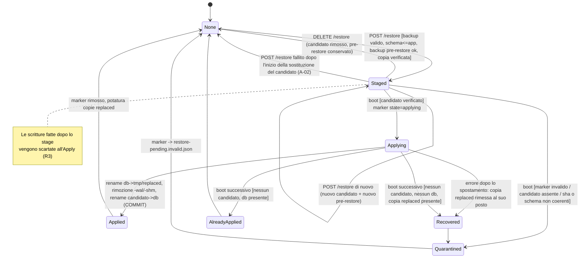
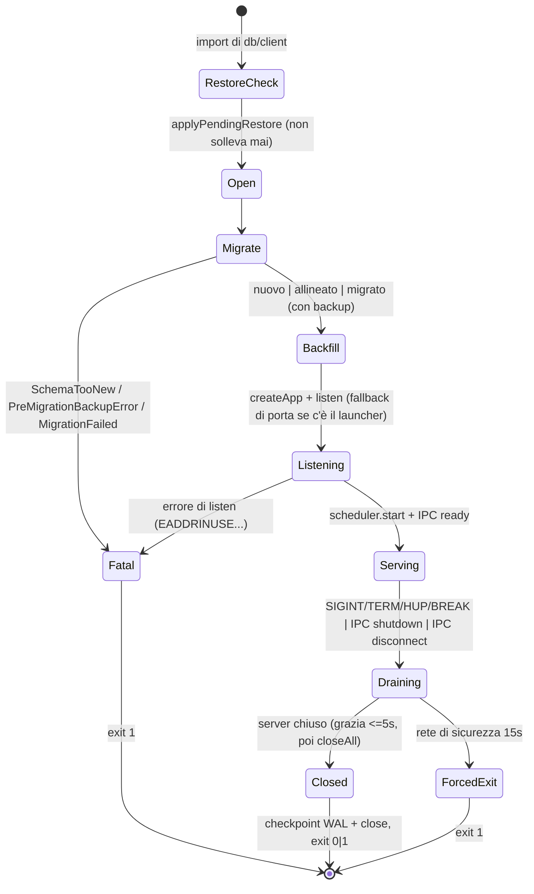
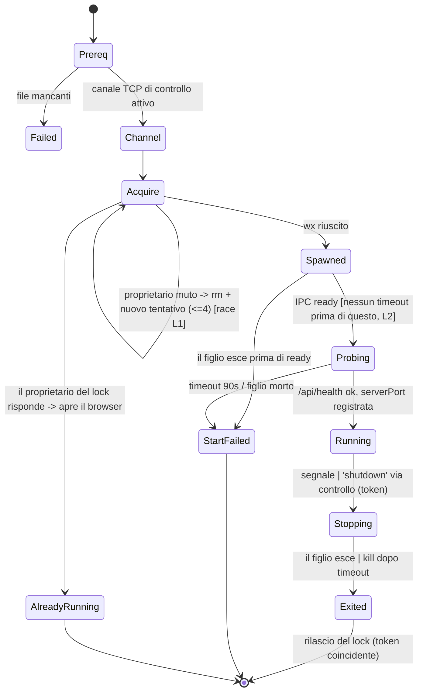
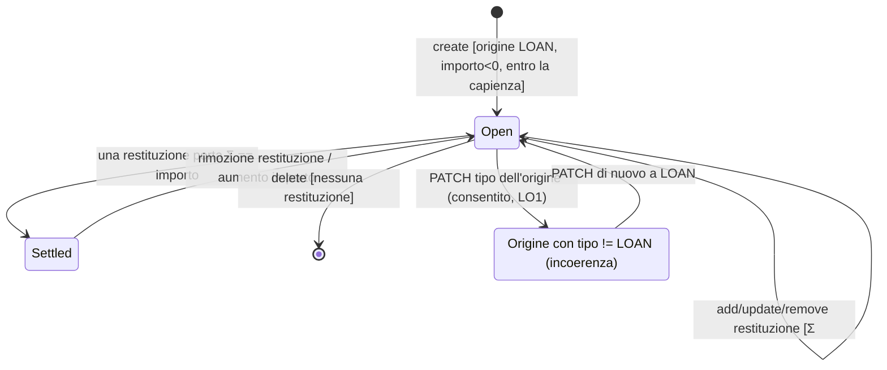
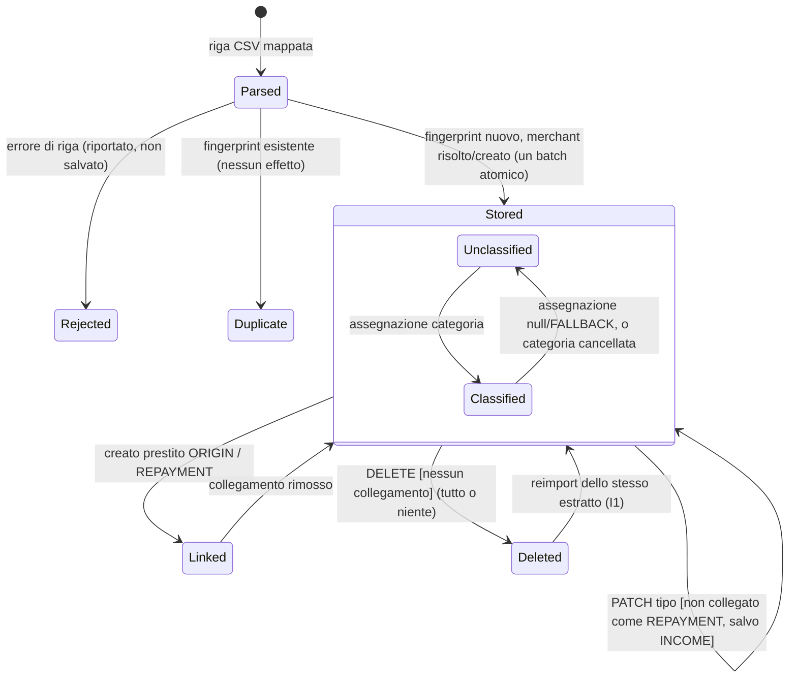
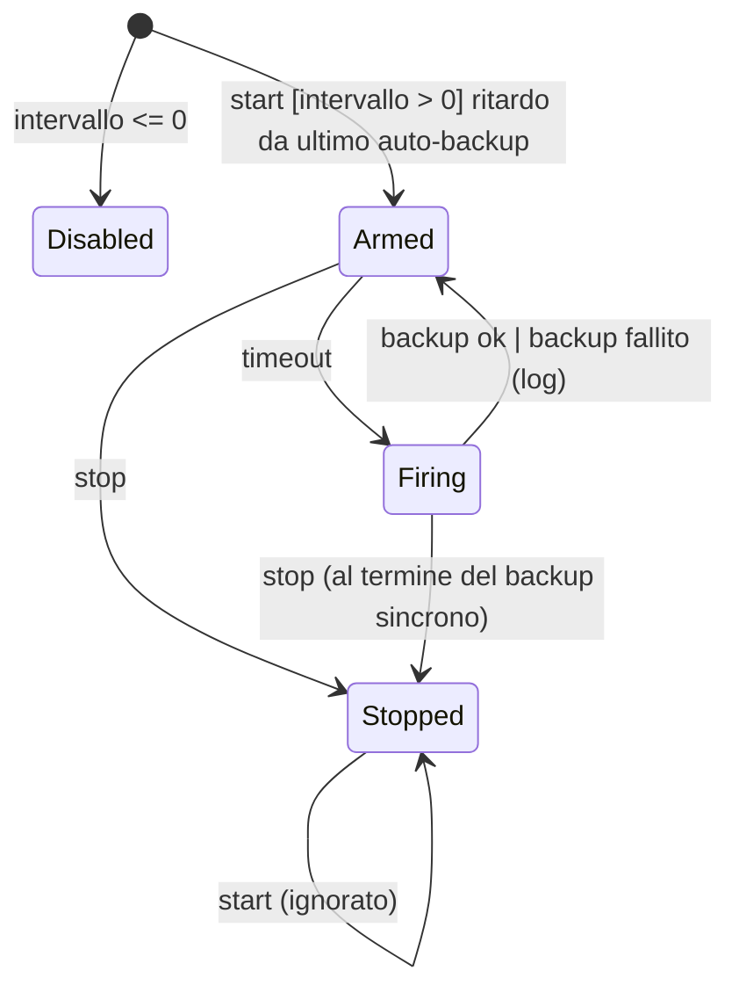
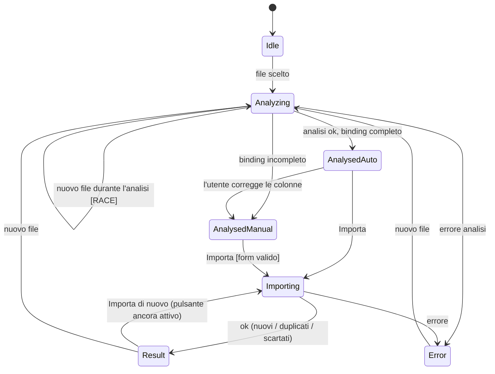
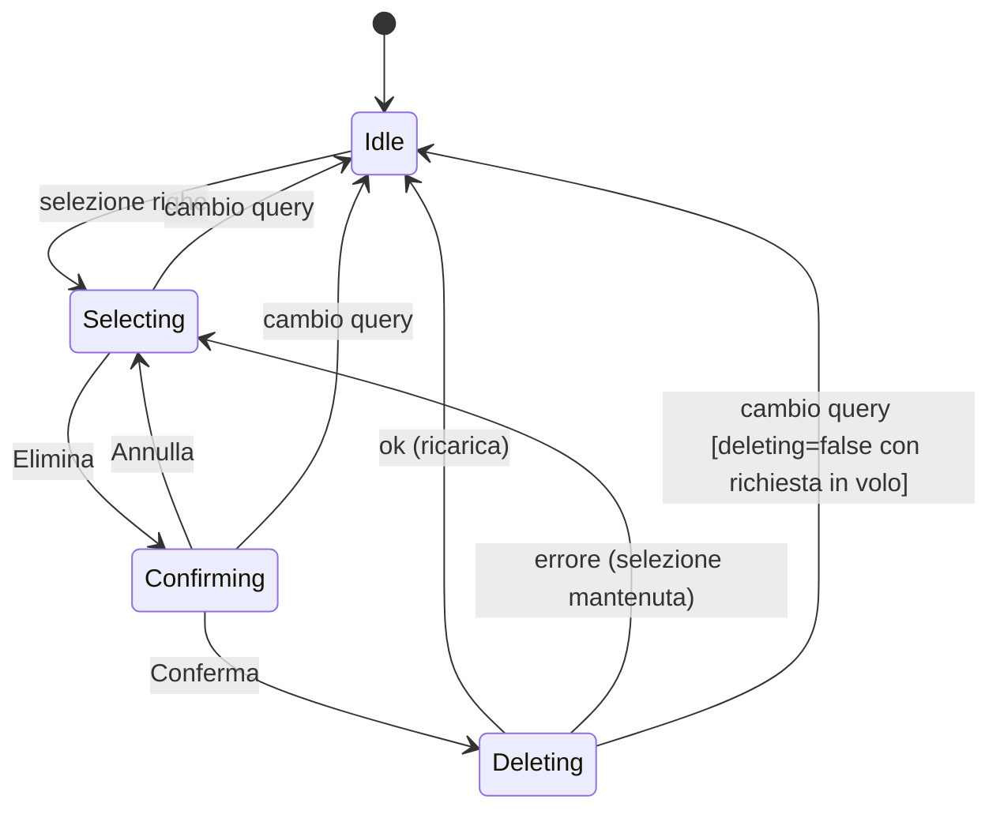

# Catalogo delle macchine a stati — Schedino

> Data: 2026-11-11 · Commit `f072a59` · Audit in sola lettura
> Documenti collegati: [AUDIT.md](AUDIT.md) · [PLAN.md](PLAN.md)

Percorsi relativi a `apps/backend/src`. `frontend/…` indica `apps/frontend/src/app`. Tag: PROVEN / LIKELY / POTENTIAL (vedi [AUDIT.md](AUDIT.md)).

La ricerca non si è fermata a enum e campi `status`. Ha considerato anche:

- booleani e campi nullable;
- presenza o assenza di file e di righe;
- valori derivati (`remainingCents`);
- marker su disco;
- lock file;
- segnali frontend combinati;
- flussi asincroni che attraversano riavvii e processi.

---

## 1. Inventario

| ID | Macchina | Classe | Dove vive lo stato | Compl. | Chiarezza | Correttezza | Robustezza | Testabilità | Costo evol. | Rischio |
|---|---|---|---|---|---|---|---|---|---|---|
| SM1 | Restore differito | Distribuita, persistita, asincrona fra riavvii | Marker JSON più file candidato, DB e copia spostata | Alta | Alta | **Media** (R1, R2) | Alta | Alta | Media | **Sì** |
| SM2 | Ciclo di vita del processo (boot → migrate → serve → shutdown) | Esplicita (fasi tipizzate) | `StartupPhase`, `MigrationOutcome`, latch `shuttingDown` | Media | Alta | Alta | Alta | Alta | Bassa | No |
| SM3 | Launcher e lock d'istanza | Distribuita (2 processi, un file, un canale TCP) | Lock file `wx` con token, figlio, IPC | Alta | Media | **Media** (L1) | Media | Alta | Media | **Sì** |
| SM4 | Ciclo di vita del prestito | Implicita, derivata | Righe `loans` e `loan_repayments`, stato calcolato | Media | Alta | **Media** (LO1) | Media | Alta | Media | Moderato |
| SM5 | Identità, tipo e classificazione del movimento | Implicita, parzialmente persistita | `fingerprint`, `type`, `merchant.category_id`, link ai prestiti | Media | Media | Alta | Alta | Alta | Media | Moderato (I1) |
| SM6 | Scheduler dei backup automatici | Esplicita, in memoria | `timer`, `stopped` | Bassa | Alta | Alta | Alta | Alta | Bassa | No |
| SM7 | Reset dell'archivio | Workflow a comando | Sequenza nel servizio | Bassa | Alta | Alta (un difetto minore) | Alta | Alta | Bassa | No |
| SM8 | Saldo iniziale | Implicita | `(initialBalanceCents, balanceDate \| null)` | Bassa | Media | Media | Media | Media | Bassa | No |
| SM9 | Migrazione dello schema | Esplicita | `SchemaComparison` | Bassa | Alta | Alta | Alta | Alta | Bassa | No |
| F1 | Wizard di importazione | Frontend, combinazione di segnali | 9 segnali più `content` non reattivo | Media | Media | Media (race) | Media | **Bassa** (nessuna spec) | Media | Moderato |
| F2 | Pagina Movimenti: query, selezione, cancellazione, modifica in linea | Frontend | URL, poi `httpResource`; 4 segnali di delete; `savingId` | Media | Alta | Alta | Media | Alta | Media | Basso |
| F3 | Creazione prestito | Frontend | Form più lookup dei link | Bassa | Media | Media | Media | Media | Bassa | Basso |
| F4 | Dettaglio prestito | Frontend | `editing`, `addingRepayment`, `confirmingDelete`, `saving` | Media | Media | Media | Media | Media | Media | Basso |
| F5 | Pannello di reset | Frontend | `aperto`, `running`, `error`, `done` | Bassa | Alta | **Media** (F04) | Alta | Media | Bassa | Moderato |
| F6 | Pagine di lettura (dashboard, analytics, merchants, loans) | Frontend | URL o store, poi `httpResource` e latch | Bassa | Alta | Alta | Alta | Alta | Bassa | Basso |
| F7 | Filtri di Analytics | Frontend, singleton | `AnalyticsStore` (`providedIn: 'root'`) | Bassa | Media | Media (ID stantii) | Media | Alta | Bassa | Basso |

Macchine che rappresentano un **rischio architetturale significativo**:

- **SM1**: un difetto causa la perdita di un backup, l'altro rende fuorviante lo stato pendente. Manca anche la UI.
- **SM3**: una race può produrre due scrittori sullo stesso archivio.
- **SM4 + SM5**: regole asimmetriche sul tipo del movimento d'origine; i movimenti cancellati riappaiono reimportando lo stesso estratto.

---

## 2. Macchine esplicite e distribuite (backend)

### SM1. Restore differito

**Responsabilità.** Sostituire l'archivio con un backup verificato senza mai farlo a database aperto.

**Componenti.**

- Preparazione via HTTP in `modules/maintenance/restore.service.ts:62-145`.
- Applicazione al boot in `modules/maintenance/restore-pending.ts:319-450`, invocata da `db/client.ts:32` prima di aprire il DB.
- Rotte in `maintenance.routes.ts`.

**Rappresentazione dello stato.** È la combinazione di:

- il marker `DATA_ROOT/restore-pending.json` con `state ∈ {staged, applying}`, oppure assente;
- l'esistenza di `tmp/restore-candidate.sqlite`;
- l'esistenza di `database.sqlite`;
- le copie `tmp/replaced-*.sqlite`;
- la quarantena `restore-pending.invalid.json`.

**Stati.** None, Staged, Applying, Applied (transitorio), AlreadyApplied, Recovered, Quarantined.

**Eventi.** `POST /api/restore` (stage), `DELETE /api/restore` (annulla), avvio del processo (apply).

**Guardie.**

- Al momento dello stage:
  - il backup deve essere valido (manifest, integrità, sha256);
  - lo schema non deve essere più recente dell'app (`compareSchema`);
  - il backup pre-restore deve riuscire;
  - la copia del candidato viene ricontrollata.
- Al boot, il candidato viene verificato di nuovo con sha256 e schema.
- Il reset è rifiutato mentre esiste un marker (`reset.service.ts:100`).

**Effetti collaterali.** Creazione di un backup, che **esegue anche la retention** (`backup.service.ts:218`). Copia e rename di file. Log.

**Stati terminali.** None, dopo Applied, AlreadyApplied o Quarantined.

**Transizioni reversibili.** Staged → None (annulla). Staged → Staged (nuovo stage).

**Transizioni vietate.** Stage mentre il marker è `applying`, che però è praticamente irraggiungibile, perché l'apply è sincrono e precede l'apertura del DB. Reset mentre esiste un marker.

**Vincolo di consistenza.** Il marker `staged` implica che il candidato esista e che il suo sha256 coincida con quello del manifest.

**Copertura dei test.** `restore-pending.test.ts:196-436` copre ogni ramo del boot, inclusi i crash a metà. Ci sono anche `restore.service.test.ts:98-270` e `restore.runtime.test.ts:258,372`.

**Problemi individuati.**

| ID | Problema | Tag | Priorità |
|---|---|---|---|
| R1 | **Il restore del backup `pre-restore` più vecchio cancella la propria sorgente.** Sequenza: `verify(X)` (`restore.service.ts:73`), poi `backupService.create('pre-restore')` (`:90`), che esegue `prune()` (`backup.service.ts:218`). Con `RETENTION['pre-restore'] = 3` (`backup.retention.ts:20`) e 3 pre-restore già presenti, il più vecchio, cioè X, viene eliminato. Poi `copyFileSync(check.file)` (`:105`) fallisce con ENOENT, quindi l'utente riceve un 500 generico e il backup scelto è perso. Lo stesso schema vale in teoria per qualunque backup che la retention ritenga scaduto in quell'istante | PROVEN (lettura del codice, non riprodotto) | P1 |
| R2 | Re-stage fallito: `rmSync(candidate)` (`:104`) avviene prima della copia e della verifica del nuovo candidato. Se queste falliscono, resta il vecchio marker `staged` che punta a un file cancellato. `GET /restore` dichiara un ripristino pendente, e al boot il marker finisce in quarantena con "candidato mancante". Fallisce in modo sicuro, ma è fuorviante | PROVEN | P3 |
| R3 | Le scritture fatte fra lo stage e il riavvio vengono scartate. Il 202 dice solo "l'archivio attuale non è ancora modificato" (`maintenance.routes.ts:95`). Le scritture sopravvivono solo in `tmp/replaced-*` (ne restano 2), senza che nessuna UI lo dica | LIKELY (lacuna di design) | P2 (come parte di F07) |
| R4 | Nessuna UI frontend per backup e restore. Il messaggio del reset rimanda a una sezione inesistente (`maintenance.routes.ts:133`) | PROVEN | P2 |
| R5 | Crash fra lo spostamento del DB e la rimozione dei sidecar: la coda WAL della copia spostata va persa (`restore-pending.ts:246,263`). Il backup pre-restore copre comunque tutto fino allo stage | POTENTIAL | P3 (solo documentare) |

**Lacune nei test.** Nessun test per R1 (restore dal pre-restore più vecchio quando ne esistono già 3). Nessun test per R2 (stage che fallisce dopo uno stage riuscito).

**Raccomandazione.** La macchina è già sufficientemente esplicita: esiti tipizzati (`RestoreOutcome`) e punto di commit dichiarato. **Non formalizzarla ulteriormente.**

- R1: copiare il candidato in `tmp/` (passi 4–5) **prima** di creare il backup pre-restore. In alternativa, escludere dalla potatura il nome in corso di ripristino.
- R2: rimuovere il marker prima di `rmSync`.
- R3/R4: vedi PLAN (attività B-03).

**Aggiornamento 2026-11-11 — A-02 implementata (R1 e R2 risolti).** Comportamento attuale di `restoreService.stage()`:

- **R1:** `backupService.create('pre-restore', moment, [name])` passa il backup scelto come nome protetto a `prune(protect)`. Il backup scelto sopravvive allo stage; dopo lo stage di un `pre-restore` vecchio i `pre-restore` sono temporaneamente 4. La protezione vale solo per quella creazione: la creazione successiva di un backup di qualsiasi tipo riporta la ritenzione a 3 e può eliminare il backup scelto. L'apply resta corretto, perché usa la copia in `tmp/`; `backupName` nel marker diventa solo un'etichetta nei log.
- **R2:** `clearPendingRestore()` è chiamato dopo verifica, controllo dello schema e backup pre-restore, subito prima di `rmSync(candidate)`. Un rifiuto (400) o un backup pre-restore fallito lasciano intatto il ripristino preparato in precedenza; un fallimento successivo lascia "nessun ripristino in attesa".
- **Test:** `restore.service.test.ts`, describe "il backup scelto e il ripristino già preparato sono protetti"; `backup.service.test.ts`, describe "ritenzione con nomi protetti".
- Resta come prima: la scrittura del marker non è atomica; un marker troncato finisce in quarantena al boot.

---

### SM2. Ciclo di vita del processo

**Componenti.** `db/client.ts` (restore, poi apertura con WAL e FK), `bootstrap.ts:23-61`, `db/safe-migrate.ts:44-87`, `server.ts:116-211` (`StartupPhase` = `bootstrap | application | listen | scheduler`, con rollback), `main.ts`, `launcher-ipc.ts:50-92`, `shutdown.ts:118-194`.

**Rappresentazione.** Fasi tipizzate. `MigrationOutcome` vale `nuovo | allineato | da-migrare | database-piu-recente`. Lo shutdown ha un latch single-flight `shuttingDown`.

**Guardie ed effetti.**

- Un backup obbligatorio precede ogni `da-migrare`, e la migrazione avviene in un'unica transazione drizzle.
- Lo shutdown procede così:
  1. ferma lo scheduler;
  2. esegue `server.close`;
  3. concede 5 s di grazia, poi chiude tutte le connessioni;
  4. una rete di sicurezza forza l'uscita dopo 15 s;
  5. esegue il checkpoint del WAL e chiude il DB.

  Il codice d'uscita è 0 solo se tutto si è chiuso pulito.

**Stati terminali.** Uscita con 0 o con 1.

**Problemi.**

- `compareSchema` confronta solo `latestMillis`: con lo stesso timestamp ma un `appliedCount` diverso, il risultato è `allineato`. Serve un journal modificato a mano (POTENTIAL, P3).
- Un fallimento del bootstrap salta di proposito `closeDatabase` (`main.ts:88`). È corretto: SQLite recupera il WAL alla prossima apertura.

**Test.** `bootstrap.test`, `safe-migrate.test`, `schema-version.test`, `server.test`, `shutdown.test`, `shutdown.unit.test`, `runtime.test`, `server.ipc.runtime.test`, `launcher-ipc.test`. La copertura è completa.

**Raccomandazione.** Nessun intervento strutturale. È il modello di riferimento del progetto.

---

### SM3. Launcher e lock d'istanza

**Componenti.** `launcher/run.ts:86-398`, `launcher/instance-lock.ts:149-250`, `launcher/control.ts`, `launcher/readiness.ts`, `launcher/main.ts`.

**Stati.**

1. Prerequisiti verificati.
2. Canale di controllo in ascolto (aperto prima del lock, `run.ts:112-134`).
3. Acquisizione del lock con `wx`, oppure "già in esecuzione" (fino a 4 tentativi di furto di un lock stantio).
4. Figlio avviato.
5. Attesa del messaggio IPC `ready`.
6. Health probe (90 s, `launcher/main.ts:102`).
7. Porta registrata nel lock e browser aperto.
8. Running.
9. Arresto: IPC `shutdown`, poi `kill` dopo un timeout.
10. Uscita: il lock viene rilasciato solo se il token coincide.

**Invariante.** Un solo server per `DATA_ROOT`.

**Problemi.**

| ID | Problema | Tag | Priorità |
|---|---|---|---|
| L1 | **Il furto del lock stantio è check-then-delete (TOCTOU).** I launcher A e B leggono lo stesso lock stantio e lo giudicano entrambi non vivo. A esegue `rmSync` e il suo `wx` riesce. B esegue `rmSync` (`instance-lock.ts:241`) e **cancella il lock appena creato da A**, quindi anche il `wx` di B riesce. Risultato: due server sullo stesso archivio. Lo scenario è proprio quello per cui il lock esiste: un doppio avvio subito dopo un crash, per esempio un doppio clic. I test (`instance-lock.test.ts:155-290`) sono solo sequenziali | LIKELY (percorso nel codice, non riprodotto) | P1 |
| L2 | Nessun timeout prima del messaggio IPC `ready` (`run.ts:253-262,318`). Un figlio bloccato prima di `ready` lascia il launcher in attesa fino a un segnale | POTENTIAL | P3 |
| L3 | Un figlio ucciso da un segnale risulta con codice 0 (`run.ts:266`, `code ?? (signal === null ? 1 : 0)`) | LIKELY | P3 |
| A8 | Il lock è acquisito solo dal launcher. Se `main.ts` viene avviato direttamente (dev o `node dist/server.js`) sulla stessa `DATA_ROOT` di un'istanza pacchettizzata, i due processi non si escludono | PROVEN / POTENTIAL | P3 |

**Raccomandazione.**

- L1: prima di `rmSync`, rileggere il file e cancellarlo solo se il `token` coincide con quello appena giudicato morto. In alternativa, rinominarlo atomicamente su un nome univoco e poi verificare. Aggiungere un test con due acquisizioni concorrenti.
- L2: un timeout configurabile su `ready`.
- A8: documentare il rischio, oppure riusare il lock in `main.ts` (vedi PLAN).

---

### SM4. Ciclo di vita del prestito (implicito, derivato)

**Rappresentazione.** Righe in `loans` e `loan_repayments`. `remainingCents = max(amount − Σrepaid, 0)`, e `status = remaining > 0 ? OPEN : SETTLED` (`modules/loans/loan.model.ts:56-63`). **Nulla è memorizzato**, quindi lo stato non può divergere dai dati. È un punto di forza.

**Comandi e guardie** (`modules/loans/loans.service.ts`):

| Comando | Riga | Guardie |
|---|---|---|
| `create` | :483 | Movimento d'origine di tipo `LOAN` con importo negativo. Σ prestiti sull'origine ≤ \|importo\| |
| `update` | :510 | Importo ≥ già restituito. `lentAt` ≤ prima restituzione. Deve stare nella capienza dell'origine |
| `remove` | :562 | Nessuna restituzione (anche FK senza cascade) |
| `addRepayment` / `updateRepayment` | :575-650 | Importo > 0, data ≥ `lentAt`, Σ ≤ importo. Il movimento collegato deve essere `INCOME` e positivo, e Σ delle restituzioni su quel movimento ≤ il suo importo |
| `removeRepayment` | :~660 | Nessuna (lato frontend: nessuna conferma, F15) |

**Transizioni.** OPEN ⇄ SETTLED in entrambe le direzioni. Non c'è uno stato terminale: la cancellazione è l'unica fine.

**Vincoli DB.** Solo FK e NOT NULL (`drizzle/0008`). **Nessun CHECK** su importi positivi, somma ≤ importo, o tipo e segno dell'origine. La clamp `max(…, 0)` nasconderebbe una violazione introdotta via SQL diretto.

**Atomicità.** Le sequenze check-then-write non sono in `atomically`. Sono sicure solo perché gli handler sono sincroni e il processo è unico. È un **invariante implicito**: un `await` fra controllo e scrittura aprirebbe una race (POTENTIAL, P3: va documentato).

**Problemi.**

| ID | Problema | Tag | Priorità |
|---|---|---|---|
| LO1 | **Regola asimmetrica sul tipo.** Il movimento d'origine può passare da `LOAN` a `EXPENSE` mentre il prestito resta OPEN: `updateType` blocca solo gli utilizzi `requiresIncome` (`transactions.service.ts:215-224`), e gli utilizzi ORIGIN non sono marcati (`loans.service.ts:466-479`). Dopo il cambio, cash-flow, analytics e dashboard contano l'intera uscita come spesa (`transaction-type.ts:111,135`), mentre la pagina Prestiti mostra ancora il credito. Lo segnala solo `transactionTypeMismatch` (`loans.service.ts:311`). Il comportamento è testato come voluto (`loans.partial-expense.test.ts:225-245`), ma per le restituzioni la regola è opposta (il tipo è bloccato) | PROVEN | P2 |
| — | Capienza del prestito ricalcolata nel frontend in euro float (`frontend/features/loans/loan-create-page.ts:~87-120`) | PROVEN | P2 (F10) |
| — | Il dettaglio offre come candidati solo le prime 100 entrate a partire da `lentAt` (`loan-detail-page.ts:55,225-233`) | POTENTIAL | P3 |

**Lacune nei test.** Nessuna sostanziale lato backend: 7 file. Manca un test che fissi la regola scelta per LO1, quale che sia.

**Raccomandazione.** Mantenere lo stato derivato e non memorizzare `status`. Decidere una sola regola per LO1. La proposta è bloccare, per simmetria: marcare gli utilizzi ORIGIN con `requiresLoan`, circa 3 righe più un test. Documentare l'invariante "handler sincroni" in `loans.service.ts`.

---

### SM5. Identità, tipo e classificazione del movimento

**Rappresentazione.**

- Identità: `fingerprint = sha256(data, centesimi, descrizione, occorrenza-nel-batch)` (`transaction-fingerprint.ts:24-60`), con UNIQUE nel DB (`0004`). Il campo è nullable per le righe storiche, e il backfill gira a ogni boot.
- Tipo: enum di 6 valori (`transaction-type.ts:16-23`), con default DB `EXPENSE` e nessun CHECK. È **l'unico campo mutabile**.
- Classificazione: `merchants.category_id` NULL (da classificare) oppure una categoria reale. La riga `FALLBACK` è solo un'etichetta (`categories.service.ts:13`). La migrazione 0009 ha eliminato la doppia rappresentazione storica.
- Link ai prestiti: ORIGIN o REPAYMENT, derivati dalle tabelle dei prestiti.

**Combinazioni segno/tipo.** Una `EXPENSE` positiva (un rimborso) non è vietata: viene assorbita aritmeticamente da `expenseCents`. È corretto ed è coperto da `dashboard/refunds.consistency.test.ts`.

**Problemi.**

| ID | Problema | Tag | Priorità |
|---|---|---|---|
| I1 | **I movimenti cancellati ritornano reimportando lo stesso estratto.** Non c'è un tombstone: `remove` cancella la riga (`transactions.service.ts:278-287`) e la deduplica guarda solo i fingerprint esistenti (`import/duplicate-detector.ts:19-25`) | PROVEN | P2 (decisione più documentazione) |
| I2 | L'identità del merchant è `normalized_name`. Cambiare `merchant-normalizer` senza una migrazione dei dati crea merchant duplicati al prossimo import | POTENTIAL | P3 (documentare) |
| I3 | Se la banca cambia la descrizione fra due esportazioni (movimento in sospeso poi contabilizzato), il movimento viene reimportato come nuovo | POTENTIAL (intrinseco al design) | P3 (documentare) |
| — | L'affermazione "le transazioni importate sono immutabili" è falsa per `type` e per la cancellazione | PROVEN | P2 (F09) |

**Raccomandazione.** Nessun cambio di modello. Per I1, decidere se "cancellato = mai importato" sia la regola desiderata. Se sì, serve una tabella di fingerprint ignorati, a costo contenuto. Se no, dichiararlo nella UI di cancellazione e nei documenti. **Non aggiungere il tombstone per default.**

---

### SM6. Scheduler dei backup automatici

**Rappresentazione.** `timer: Timeout | null` e `stopped: boolean` (`modules/maintenance/backup.scheduler.ts:161-229`).

**Stati.** Disabled (intervallo ≤ 0), Armed, Firing, Stopped (terminale: `start` dopo `stop` non fa nulla).

**Design.** Un `setTimeout` riarmato dopo ogni esecuzione, quindi senza sovrapposizioni per costruzione. Il primo ritardo è calcolato dal backup automatico più recente su disco, e un backup datato nel futuro conta come fresco. Il timer è `unref`. Un backup fallito riarma il timer. Lo scheduler è il primo componente fermato nello shutdown (`shutdown.ts:131`).

**Test.** `backup.scheduler.test.ts`, con timer finti. Esemplare. **Nessun intervento.**

---

### SM7. Reset dell'archivio

**Flusso** (`modules/maintenance/reset.service.ts:91-166`):

1. guardia: rifiuta se c'è un restore pendente;
2. conteggio delle righe;
3. backup `pre-reset`, con abort se fallisce;
4. in un unico `atomically`: `defer_foreign_keys`, cancellazione di tutte le tabelle utente **tranne `categories`**, nuovo seed di `settings` a `(0, null)`;
5. `VACUUM`, fuori dalla transazione.

**Problemi.**

- `VACUUM` gira dopo il commit (`:161`). Se fallisce (serve circa il doppio dello spazio libero), il client riceve un 500 anche se il reset è avvenuto (LIKELY, P3).
- Le categorie create dall'utente sopravvivono all'"azzera", contrariamente a quanto suggerisce l'etichetta "da zero". Va verificato se è voluto (P3).
- Lato frontend, la pagina Impostazioni non si aggiorna dopo il reset (F04, vedi F5).

**Raccomandazione.** Catturare e loggare l'errore del `VACUUM` restituendo comunque il successo. Chiarire nel testo del pannello che le categorie vengono conservate.

---

### SM8. Saldo iniziale

**Rappresentazione.** `(initialBalanceCents, balanceDate | null)`. Il cash-flow interpreta `balanceDate = null` come "saldo precedente a tutti i movimenti" (`modules/cash-flow/cash-flow.service.ts:100,185-194`).

**Ambiguità.** `(0, null)` è il seed per "sconosciuto" (commento in `0007`) e non si distingue da un utente che è partito davvero da 0. Una riga mancante restituisce in silenzio `DEFAULTS` (`settings.repository.ts:13-15`). Il seed è definito in 3 punti (Q6).

**Raccomandazione.** Aggiungere un flag "non configurato" solo se la UI dovrà mostrarlo. Ridurre il seed a una sola definizione esportata.

---

### SM9. Confronto e migrazione dello schema

`SchemaComparison` vale `nuovo | allineato | da-migrare | database-piu-recente` (`db/schema-version.ts`, `db/safe-migrate.ts:44-87`). È esplicita, tipizzata e testata (`safe-migrate.test.ts:75` verifica perfino il contenuto del messaggio). Unico limite: confronta solo `latestMillis` (vedi SM2). **Nessun intervento.**

---

## 3. Macchine frontend

### F1. Wizard di importazione

**Componente.** `frontend/features/import/import-page.ts`.

**Stato.** Segnali `fileName`, `analysis`, `analyzing`, `importing`, `result`, `error`, `mode` (`auto | manual`), `form`, `errors`, più il campo **non reattivo** `content`.

**Stati effettivi.** Idle, Analyzing, Analysed(auto), Analysed(manual), Importing, Result, Error. Un nuovo file azzera tutto (`:165-173`).

**Problemi.**

- **Race** (PROVEN nel codice, effetto POTENTIAL). Se si sceglie il file B mentre l'analisi di A è in corso, la risposta di A arriva dopo e imposta `analysis` e `form` (`:97-100`), mentre `content` è già di B. Un import manuale invierebbe quindi B con la mappatura di A. `analyzing` viene azzerato dalla prima risposta che arriva.
- L'input file non è disabilitato durante `importing`.
- Dopo un import riuscito il pulsante resta attivo. Un secondo clic reinvia il file, e il backend lo deduplica, quindi non c'è rischio sui dati.
- Nessuna spec per la pagina.

**Raccomandazione.** Memorizzare un token (il riferimento a `content`) e confrontarlo prima di ogni `set`. Disabilitare l'input durante l'import. Considerare `Result` uno stato finale fino al prossimo file. Una spec di pagina che copra i quattro percorsi.

### F2. Pagina Movimenti

- **URL come unica fonte di verità:** query, poi `httpResource` (`transactions-page.ts:70-79`). Punto di forza.
- Selezione e stato di cancellazione si azzerano al cambio di query (`:185-189`). Il commento in `createSelectionState` dice però che gli ID "restano validi al cambio pagina", in contraddizione con il comportamento.
- **Stato di cancellazione.** Sono 4 segnali indipendenti (`transaction-delete.ts:18-81`): 16 combinazioni, di cui circa 5 legali, mantenute coerenti dal percorso del codice. Il `reset()` nell'effetto di query può riportare `deleting=false` mentre una richiesta è in volo, quindi un secondo clic può inviarne un'altra. Il backend risponde `notFound`, senza corruzione (P3).
- **Modifica in linea.** Lo slot `savingId` è uno solo (`transaction-edits.ts:55-69`): due modifiche concorrenti si cancellano a vicenda l'indicatore (PROVEN, cosmetico).
- Dopo una cancellazione, la pagina fuori intervallo resta nell'URL. Il server la limita (`transactions.service.ts:179-194`).

**Raccomandazione.** Un'unione discriminata (`{kind: 'idle' | 'confirming' | 'deleting' | 'failed'}`) eliminerebbe le combinazioni impossibili. Il valore è basso: farlo solo se si tocca il file.

### F3. Creazione prestito

`prefill()` viene eseguito due volte (`loan-create-page.ts:164` e `:166-176`). La seconda esecuzione, dopo l'arrivo dei link, sovrascrive l'intero form e cancella quanto digitato nel frattempo (PROVEN, impatto basso). La capienza è ricalcolata lato client (vedi SM4).

### F4. Dettaglio prestito

`editing`, `addingRepayment`, `confirmingDelete` e `saving` sono indipendenti: possono essere tutti veri contemporaneamente e condividono `actionError`. Le scritture sono protette da `[disabled]="saving()"`. La rimozione di una restituzione non chiede conferma (F15). Un'unione discriminata per "pannello attivo" ridurrebbe le combinazioni, ma è opzionale.

### F5. Pannello di reset

`aperto`, `running`, `error`, `done`. Interno coerente. **Problema di confine:** il pannello è incorporato in `SettingsPage` ma non emette alcun evento a reset completato. La pagina mantiene il form caricato una sola volta in `ngOnInit` (`settings-page.ts:52`), quindi mostra e può risalvare valori che il reset ha appena azzerato (F04, PROVEN, P2).

### F6. Pagine di lettura

Dashboard, analytics, merchants e loans seguono lo stesso schema: criteri, poi `httpResource`, poi un latch che mantiene l'ultimo valore attenuato. Coerente, ma il latch è riscritto 3 volte (Q7). Movimenti non usa il latch, quindi la tabella lampeggia al cambio di filtro.

### F7. Filtri di Analytics

`AnalyticsStore` è `providedIn: 'root'`. I filtri sopravvivono alla navigazione ma non al ricaricamento. L'intervallo iniziale viene calcolato una sola volta da `new Date()`. Dopo la cancellazione di una categoria o un reset, gli ID stantii restano nei filtri (LIKELY). È incoerente con le altre pagine, che tengono i criteri nell'URL.

---

## 4. Problemi trasversali allo stato

| Tema | Osservazione | Tag |
|---|---|---|
| Stato duplicato FE/BE | `FALLBACK_CATEGORY_ID`, la capienza del prestito e i limiti dei periodi sono ricalcolati nel frontend | PROVEN |
| Invarianti solo applicativi | Capienza dei prestiti, segno e tipo, categoria FALLBACK: nessun CHECK nel DB | PROVEN |
| Atomicità implicita | La sicurezza delle sequenze check-then-write dipende da handler sincroni e da un solo processo (SM3 + better-sqlite3) | PROVEN / POTENTIAL |
| Orologi | Il frontend usa l'orologio del browser per i periodi, la dashboard il `today` del server | PROVEN |
| Stato che attraversa i riavvii | Solo SM1 (marker), ed è ben progettato | PROVEN |

---

## 5. Lacune nei test (riepilogo)

| Macchina | Test mancante | Priorità |
|---|---|---|
| SM1 | Restore dal pre-restore più vecchio con 3 già presenti (R1) | P1 |
| SM1 | Stage fallito dopo uno stage riuscito: il marker non deve sopravvivere (R2) | P3 |
| SM3 | Due `acquireInstanceLock` concorrenti su un lock stantio (L1) | P1 |
| SM4 | Regola scelta per il cambio di tipo dell'origine (LO1) | P2 |
| SM5 | Comportamento atteso del reimport dopo una cancellazione (I1), una volta decisa la regola | P2 |
| SM7 | `VACUUM` fallito dopo il commit | P3 |
| F1 | Spec della pagina Import, race fra due analisi inclusa | P2 |
| F5 | Reset seguito da ricarica del form Impostazioni | P2 |

---

## 6. Raccomandazioni

1. **Non introdurre librerie FSM né state machine formali.** Le macchine critiche del backend (SM1, SM2, SM6, SM9) sono già esplicite: esiti come unioni tipizzate, punti di commit dichiarati, test per ramo. Il problema non è la rappresentazione: sono due difetti puntuali (R1, L1).
2. **Correggere R1 e L1** con interventi locali e un test ciascuno.
3. **Decidere LO1 e I1** come regole di prodotto, poi fissarle con un test e una frase nei documenti.
4. **Documentare gli invarianti impliciti**: handler sincroni, single-writer, "aggiungere un tipo richiede di toccare `transaction-type.ts` e la correzione del cash-flow".
5. **Frontend.** Correggere F1 (token) e F5 (evento di reset). Le unioni discriminate per F2 e F4 sono opzionali, da fare solo quando si lavora già su quei file.
6. **Mantenere lo stato derivato** (SM4) e non memorizzare mai `status` o `remaining`.
